# Owlio Educator Sidebar and Workflow Megaplan

Recommend a school-educator-first navigation and end-to-end teaching workflow, with page-level requirements, current frontend/API status, ownership safeguards, and a backend-aware delivery roadmap.

This is the detailed School Educator workspace specification linked from the [Owlio Product Plan](OWLIO_PRODUCT_PLAN.md#4-four-role-workspaces-and-their-connected-learning-contexts). Use the product plan for shared capabilities, cross-role ownership boundaries, and delivery dependencies; use this document for educator navigation, page requirements, click flows, and acceptance criteria. Current source, runtime flags, and confirmed backend contracts determine implementation status; the current-state snapshots below must be rechecked before implementation.

## Objective and confirmed decisions

- Deliver a product/UX proposal, a codebase capability map, and a sequenced roadmap for the educator workspace.
- Current focus is school teachers and instructors. Keep the shared classroom model extensible to tutors and ESL educators, but do not make their distinct teaching/scheduling needs the primary scope of this plan.
- Keep **Meeting Room** as a separate standalone page and sidebar destination. Classes and scheduled sessions can deep-link to that page with the correct room context.
- Replace a general **Messages** inbox with contextual **Discussions** for the first educator workflow. Direct messaging remains future until product, delivery, privacy, and backend contracts are approved.
- Keep **Teaching Materials** in one sidebar location, not duplicated in Planning and AI & Insights.
- Split **Attendance** and **Gradebook** into separate destinations; they are different official-record workflows. Link them to the same classroom, session, and assessment contexts where useful.
- Treat product-plan capabilities as target behavior, not evidence of current implementation. Do not invent API routes, permissions, scoring policies, supported upload types, or saved states.

## Recommended educator sidebar

```text
Overview

TEACHING & MANAGEMENT
- My Classes
- Classwork & Assessments
- Students
- Attendance
- Gradebook

COMMUNICATION
- Meeting Room
- Discussions
- Announcements
- Notifications

PLANNING
- Lesson Planner
- Calendar & Schedule
- Teaching Materials

AI & INSIGHTS
- AI Form Assistant
- Teaching Insights

ACCOUNT
- Profile & Settings
```

### Rationale and additions

- Add **Notifications**. It is part of the product workflow and already has a route, but is missing from the proposed educator navigation.
- Add **Lesson Planner**. The product is lesson-centered: one lesson connects objectives, schedule, meeting information, materials, activities, and educator notes. Calendar, materials, and classwork pages alone do not provide a coherent lesson-preparation workflow. Keep lesson records associated with a class and avoid a second, conflicting calendar.
- Add **Teaching Insights** under AI & Insights to replace the duplicate Teaching Materials item. It should summarize real, authorized classroom information (for example, submissions awaiting review or attendance patterns), show sources/time ranges, and support educator decisions without unsupported risk labels or opaque automated judgments.
- Keep **Students** as the educator-wide roster/search entry. Classroom-specific membership and record access must remain scoped to classes the educator owns or is authorized to manage.
- Keep **Classwork & Assessments** focused on authoring activities, distribution, submission review, and feedback. Keep **Gradebook** focused on viewing/managing official released or draft results across activities under an approved grading policy.
- Keep **Attendance** focused on session-based official attendance, not as a secondary view of meeting-room presence.
- Keep **Meeting Room** as its own full page rather than embedding the entire call UI in My Classes. Class/session links should deep-link into that same page; the standalone entry must not imply a room history or meeting schedule unless those are backed by services.
- Use **Discussions** for messages attached to a classroom, lesson, or activity. General educator-to-student direct messages are a separate future capability and should not be implied by the contextual discussion UI.
- Keep **Announcements** as a distinct educator-authored notice workflow, and **Notifications** as the event inbox. An announcement is a post; a notification is a delivery/read event only when the service confirms it.
- Keep **Profile & Settings** at the bottom/account area. It is a target destination; profile editing and settings persistence are not currently implemented.
- Do not add more top-level items for submission queues, individual assessments, class rosters, or lessons inside a class. Surface those as filters, tabs, or contextual actions within the destinations above to keep the sidebar manageable.

## Educator workflow model

1. Sign in and open an educator-authorized workspace.
2. Review Overview for today's classes, scheduled lessons, submissions to review, attendance to record, and important updates.
3. Create or open a class; configure its school/course context and manage enrollment using only supported invite methods.
4. Plan lessons and schedule sessions; attach approved materials and activities to the right class/lesson.
5. Create classwork or assessments, review the draft, then publish to the intended class.
6. Monitor submissions; review evidence and provide educator-controlled grades/evaluations and feedback.
7. Record or confirm attendance for the applicable session; do not infer attendance from meeting presence.
8. Communicate through class-scoped discussions and announcements; use the standalone Meeting Room for live teaching.
9. Review authorized student/class progress and reports, then use insights as decision support rather than automated academic judgment.

## Page content and behavior

### Overview

**Purpose:** Give the educator a reliable teaching-day starting point and direct them to the next important action.

- Today's/upcoming classes and lessons, with class name, time, classroom context, and a meeting action only when a valid meeting is attached.
- A prioritized action queue: submissions awaiting review, attendance needing confirmation, drafts or upcoming work, and important class updates, when real data exists.
- Shortcuts for creating a class, lesson, classwork/assessment, or announcement.
- A concise classroom summary with links to the relevant class pages. No fabricated student counts, review totals, activity, or progress figures.
- Useful first-run states: create a class, plan a lesson, or set up class materials; errors should identify unavailable service/data without suggesting actions were saved.
- Existing route: `/educators`. The current page already provides shortcuts and intentionally empty states, but class/session records and action counts are not connected.

### My Classes

**Purpose:** Create and manage the educator's authorized classes as the root of class-specific teaching work.

- List classes with subject/course, section where applicable, term/status where supported, next lesson, and enrollment summary from real authorized data.
- Create-class workflow for the currently confirmed fields and API contract; do not add unconfirmed fields such as school-year hierarchy or grading schemes.
- Enrollment/invitation actions using supported class codes, links, or invitations. Confirm whether code rotation, expiration, and invite revocation exist before showing controls.
- Class detail page should keep context visible and group: overview, roster, lessons/schedule, materials, classwork, discussions/announcements, attendance, and gradebook/progress.
- Class membership and ownership are enforced server-side. Do not treat role-prefixed URLs or hidden buttons as authorization.
- Existing routes: `/educators/classrooms`, `/educators/classrooms/:classroomId`. Classroom list/create/join requests exist, but the provider currently mixes connected classroom headers with mock classes and in-memory prototype details.

### Classwork & Assessments

**Purpose:** Own the activity lifecycle, from educator draft through learner submission review and feedback.

- Cross-class list with filters for class, activity type, draft/published state, due date, and review status, using only states defined by the API.
- Provide a clear **Create activity** flow for form-based assessments (quizzes/tests/practice) and non-form classwork (written/file/link/practical/discussion/reading activity) as supported.
- Form authoring should support teacher-controlled instructions, questions, answer keys/points and other scoring criteria only when specified by the backend contract. Keep activity content tied to its class.
- Submission queue should support review by class/activity/student, missing work when reliably derivable, supported evidence preview, grade/evaluation, written feedback, and return/revision where the contract allows it.
- Distinguish unpublished drafts, published activities, in-progress work, submitted work, review, and released results according to the actual server lifecycle; do not hard-code the product-plan example status flow prematurely.
- Show the human educator as final decision-maker for every official grade/evaluation. AI suggestions remain drafts until explicitly reviewed and accepted.
- Existing `/educators/classwork` is a sample weekly activity board, not connected to classroom data. Creation/review in classroom detail is a temporary in-memory prototype; no classwork/submission API service is present.

### Students

**Purpose:** Give educators a searchable, class-scoped directory of students and a safe path to the records they are permitted to review.

- Search/filter by class, enrollment state, and supported student identifier; do not expose private data outside authorized classes.
- Student detail should provide class membership and relevant classroom context, with separate areas for classwork/submissions, released results/feedback, attendance, and learning activity.
- Use actionable, sourced summaries (e.g. unreviewed submission or unconfirmed attendance) rather than generalized judgments about a student's ability or engagement.
- Provide unavailable/permission-denied states and avoid rendering a multi-class global record unless access to every included classroom is confirmed.
- Existing `/educators/learners` provides board/table/list mock views with hard-coded sample students, classes, attendance, submissions, and results; there is no student/roster service.

### Attendance

**Purpose:** Record official attendance for a selected class session and review the authorized history.

- Select a real class and session/date first; show class, session, local/timezone context, roster state, and whether the record is not recorded, pending review, or confirmed only if those states are supported.
- Educator roll call supports present, absent, late, and excused only when these are approved record values. Provide a review/confirm step where required by the backend contract.
- Support attendance history by session and student with date/class filters and accessible non-color status labels.
- Student self-check-in is a separate optional workflow, only during eligible active sessions and only if the product/backend contract supports it.
- Meeting-room participant presence, connection duration, chat, and raised hands are not official attendance and must not auto-populate or confirm the register.
- Existing `/educators/attendance` is entirely sample data. Filters and roll-call controls are disabled, and no attendance service exists.

### Gradebook

**Purpose:** Give educators a class/term-level view of official assessment results and controlled grading actions.

- Choose class and grading period/term only if those concepts exist in the school/backend contract.
- Display one authorized student per row and assessments/results as columns or activity groups; show points, maximum points, scale, missing/incomplete state, draft/released status, and feedback only according to approved policy.
- Connect each result to its source classwork item so the gradebook does not create a second grading authority or contradict the activity review screen.
- Make grade calculation, weights, rounding, late policies, overrides, release, revision/audit history, and student visibility explicit backend/product decisions; do not invent a grade scale or calculate a final grade from incomplete data.
- Export only when a protected export contract defines authorization, filters, format, and audit/privacy handling.
- No gradebook route or grade service currently exists. The shared `/educators/progress` page is a generic empty-state preview, not a gradebook.

### Meeting Room

**Purpose:** Provide the educator's standalone live teaching room while preserving classroom/session context.

- Keep a distinct page with a lobby/create-or-join state and a connected-room state. Class details and the schedule may deep-link to the page with the selected room.
- Show an educator host/room-creation action only where the backend-authorized role permits it; joining requires a valid invite/code and a successful server response.
- Media remains opt-in. Chat and hand-raise packets are scoped to the current LiveKit room and transient; they are not persisted discussions, announcements, attendance, or session analytics.
- End/leave states should clean up local media and transient room state. Do not imply recordings, attendance capture, room history, or notifications without approved services.
- Existing `/educators/classrooms/meeting-room` is a full standalone page. Meeting create/join/end API calls and LiveKit media/presence are integrated; the enclosing classroom/session record and backend authorization remain authoritative.

### Discussions

**Purpose:** Keep classroom conversations attached to the right class, lesson, or activity.

- Show classroom context, author, timestamp, thread/reply structure, and allowed audience.
- Provide educator and learner participation/actions only as supported by role and classroom permissions. No general direct-message inbox in the first release.
- Keep meeting-room chat separate from saved class discussions. Safely render untrusted text and avoid exposing private feedback or grades in public threads.
- Existing `/educators/communication` is a UI-only discussions/announcements/polls preview. Classroom feed mutations currently change in-memory demo state only.

### Announcements

**Purpose:** Publish educator-authored class notices such as schedule changes, instructions, or reminders.

- Compose from an authorized class context; identify the intended class/audience and preview what will be published.
- List published and draft notices only if drafts/statuses are service-backed. Editing, retracting, pinning, scheduling, and notification fan-out require explicit product/API support.
- Keep an announcement distinct from an assessment, a threaded discussion, and an outbound direct message. Do not claim delivery to learners unless the service confirms it.
- Existing UI represents announcements as a communication tab and class-feed prototype. There is no announcements service.

### Notifications

**Purpose:** Let educators act on confirmed events without duplicating the source records.

- Link to the originating class, activity, submission, session, discussion, or result.
- Potential events: submission received, work due, class invitation/membership change, learner discussion reply, announcement, schedule change, or attendance action. Use only events and read/unread state the API exposes.
- Protect learner data in previews and avoid repeated/noisy alerts. Delivery/read state is not assumed from a frontend click.
- Existing `/educators/notifications` is an informative empty state; no notification delivery or read-state service exists.

### Lesson Planner (recommended addition)

**Purpose:** Join class teaching plans, scheduled lessons, activities, materials, and meeting context into an educator's lesson workflow.

- Show lessons by class and date; a lesson detail can include objectives, teaching notes, linked resources, classwork, schedule, and meeting action where supported.
- Let educators plan upcoming lessons and reuse approved materials. Do not duplicate the calendar as a second independent schedule or imply lesson records saved without a service.
- For this school-focused plan, use school-appropriate class/lesson language while keeping the shared data model adaptable to tutoring/ESL later.
- There is no educator-specific lesson-planning route. Classroom detail has a prototype Schedule tab; `/educators/schedule` is only a calendar shell.

### Calendar & Schedule

- Combine class sessions, lesson dates, assessment deadlines, and other supported teaching events; visually distinguish event types and link each to its owning class/activity.
- Offer practical calendar views and a selected-day agenda; event creation/editing should reflect the educator's allowed ownership and the event API.
- Define timezone, recurrence, daylight-saving, all-day, reminder, and cancellation behavior before implementation. Don't imply external calendar sync or email/push reminders without approved integrations.
- Existing `/educators/schedule` renders a navigable month grid but loads/saves no events.

### Teaching Materials

**Purpose:** Provide one teaching-resource library that can be organized and reused without losing classroom/lesson context.

- Organize resources by authorized class, topic/unit, and lesson; show title, type, creator/source, and relevant context.
- Support linking existing material to a lesson/activity and explicit sharing/visibility; educator-private drafts must not become learner-visible by accident.
- File upload formats, size limits, previews, versioning, deletion, storage, external links, and scanning are product/backend decisions, not UI assumptions.
- Existing `/educators/materials` is a context-selection page that links to classrooms/lessons. It cannot browse/upload resources; no materials service exists.

### AI Form Assistant

**Purpose:** Reduce educator authoring time while preserving educator authorship and control over published assessments.

- Make the assistant available from the Classwork & Assessments form builder and from its sidebar entry. The sidebar entry should start a draft flow and then require a target class before publish; do not create an isolated generator with no destination.
- Collect teacher-defined subject, topic, learner level, learning objective/criteria, activity/question types, and difficulty only as supported; generate editable suggestions, not final assessments.
- Let the educator inspect/edit/reject/regenerate questions, answer choices, expected answers, and scoring details before saving or publishing. Identify AI-generated draft content clearly.
- Never publish, assign, grade, message learners, or alter official records as an AI side effect. Educator approval is mandatory; no student/private data is sent to a provider without approved privacy/backend contracts.
- Existing `/educators/ai-assistant` is shared teaching-preparation copy with no AI provider or generation flow. No AI service exists.

### Teaching Insights

**Purpose:** Summarize authorized class activity to help educators decide what to review next.

- Candidate views: submissions waiting for review, incomplete work, attendance patterns, assessment outcomes, and class/learner progress over an explicit date range.
- Give every metric its class, source, and time range. Use textual summaries and accessible chart equivalents; omit values where data is missing or stale.
- Avoid opaque risk scoring, definitive student labels, or automated intervention recommendations without an approved policy and validated data. Insights are decision support, not grades or learner records.
- Sensitive reports and exports require authorized scope and a service contract. Existing `/educators/progress` is a no-data scaffold; educator learner-board metrics are sample-only.

### Profile & Settings

- Target content may include educator identity/profile, preferences, notification settings, and sign-out, but only implement editable settings backed by authenticated APIs.
- School, account type, and role should come from confirmed identity/profile contracts, not client-side choices or an assumed onboarding subtype.
- The current dashboard header displays authenticated name/role and supports sign-out; there is no profile/settings route or profile-update service.

## Route and component implementation blueprint

This is the target frontend architecture, not a declaration that every route or operation already exists. `E` means an existing route, `P` means a proposed route, and `D` means a sidebar item that should remain visibly disabled/planned until its route and service are approved.

### Route inventory

| Sidebar destination | Route | Status and intended route behavior |
|---|---|---|
| Overview | `/educators` | E. Teaching-day dashboard. |
| My Classes | `/educators/classrooms` | E. Existing shared class list/create flow; opens `/educators/classrooms/:classroomId`. |
| Classwork & Assessments | `/educators/classwork` | E. Current sample weekly board; target cross-class activity and review queue. |
| Students | `/educators/learners` | E. Current sample learner board; target authorized roster/directory. Keep existing path for compatibility. |
| Attendance | `/educators/attendance` | E. Current disabled sample board; target official session register/history. |
| Gradebook | `/educators/gradebook` | P. New educator route; do not point to generic Progress and claim gradebook behavior. |
| Meeting Room | `/educators/classrooms/meeting-room` | E. Standalone shared LiveKit page. Class/session actions may deep-link with a valid room query. |
| Discussions | `/educators/communication` | E. Shared contextual communication preview; direct messages are not part of this plan. |
| Announcements | `/educators/announcements` | P. Separate destination; existing Communication tab is not a persisted announcement route/service. |
| Notifications | `/educators/notifications` | E. Empty-state preview; delivery/read state is not connected. |
| Lesson Planner | `/educators/lessons` | P. New educator route for reusable lesson preparation and class-linked delivery. |
| Calendar & Schedule | `/educators/schedule` | E. Generic calendar grid with no loaded/saved events. |
| Teaching Materials | `/educators/materials` | E. Resource-context chooser; no library/upload service. |
| AI Form Assistant | `/educators/ai-assistant` | E. Educator-preparation scaffold; no generation service. |
| Teaching Insights | `/educators/progress` | E. Generic no-data scaffold; target educator-only, sourced insights. |
| Profile & Settings | `/educators/settings` | P. New destination only after profile/preferences API is defined. |
| Student detail (supporting route) | `/educators/learners/:learnerId` | P. Deep route from the existing learner directory; records remain scoped to the learner's authorized class context. |

### `index.tsx`-only route adapters

- Every route directory under `src/pages/` should contain only `index.tsx`. Each adapter imports one feature view and returns it; do not put screen JSX, state, mock arrays, forms, requests, or business rules in the route adapter.
- Register routes in `src/main.tsx`; keep role-prefixed URLs under `/educators`. The route prefix is navigation context, not authorization.
- Existing educator route folders `classwork`, `attendance`, and `learners` already use `index.tsx`. Proposed `gradebook`, `lessons`, `announcements`, and `settings` folders should each start with only `index.tsx`.
- Shared classroom exceptions are `src/pages/dashboard/classroom/detail.tsx`, `activity.tsx`, `meeting-room.tsx`, and `meeting-room.lazy.tsx`. A separately approved cleanup can move these to `classroom/detail/index.tsx`, `classroom/activity/index.tsx`, and `classroom/meeting-room/index.tsx` while keeping current URLs and lazy loading.
- `src/pages/dashboard/layout.tsx` is a shared layout route, not educator page content. Move it to a layout component under `src/components/layouts/` only as a separate cross-app architecture change. Likewise, root `src/pages/App.tsx` is outside this educator feature scope.
- Shared screens under `classroom`, `schedule`, `materials`, `communication`, `notifications`, `progress`, and `ai-assistant` should delegate to feature components. Add educator-specific behavior as role-aware feature components; avoid duplicating the shared classroom implementation.
- Use the checked-in Base UI-based wrappers as used by neighboring code. Use `Button render={<Link to="..." />}` for links; do not assume Radix `asChild`. The local `Tabs` uses `value` and `onValueChange`.

### File placement and component ownership

The filenames below describe target locations, not files to create in this documentation change. `(E)` means an existing view or adapter; `(P)` means proposed.

```text
src/pages/dashboard/educators/
  index.tsx                          # E: route adapter -> EducatorOverviewView
  classwork/index.tsx                # E: route adapter -> EducatorClassworkView
  learners/index.tsx                 # E: route adapter -> EducatorStudentsView
  learners/detail/index.tsx          # P: route adapter -> EducatorStudentDetailView
  attendance/index.tsx               # E: route adapter -> EducatorAttendanceView
  gradebook/index.tsx                # P: route adapter -> EducatorGradebookView
  lessons/index.tsx                  # P: route adapter -> EducatorLessonPlannerView
  announcements/index.tsx            # P: route adapter -> EducatorAnnouncementsView
  settings/index.tsx                 # P: route adapter -> EducatorSettingsView

src/pages/dashboard/classroom/
  index.tsx                          # E: shared class list adapter
  detail/index.tsx                   # P migration of current detail.tsx adapter
  activity/index.tsx                 # P migration of current activity.tsx adapter
  meeting-room/index.tsx             # P migration/lazy adapter for current meeting-room view

src/components/features/
  educator-overview/
    educator-overview-view.tsx       # P: dashboard composition
    teaching-day-agenda.tsx          # P: upcoming lesson/session list
    needs-attention.tsx              # P: sourced submission/attendance actions
  educator-classwork/
    educator-classwork-view.tsx      # P: refactor existing sample page
    activity-list.tsx                # P
    submission-review-queue.tsx      # P
    activity-builder/                 # P: activity form sections/schema
    activity-detail.tsx              # P
  educator-students/
    educator-students-view.tsx       # P: refactor existing sample learner page
    student-directory.tsx            # P
    student-detail-view.tsx           # P: scoped student record overview
  educator-attendance/
    educator-attendance-view.tsx     # P: refactor existing sample page
    session-picker.tsx                # P
    attendance-roster.tsx             # P
    attendance-history.tsx            # P
  educator-gradebook/
    educator-gradebook-view.tsx       # P
    gradebook-grid.tsx                # P
    grade-detail-panel.tsx            # P
  educator-lessons/
    educator-lesson-planner-view.tsx  # P
    lesson-plan-editor.tsx            # P
    lesson-workspace.tsx              # P
  educator-announcements/
    educator-announcements-view.tsx   # P
    announcement-composer.tsx         # P
  educator-insights/
    educator-insights-view.tsx        # P; can mount from educator Progress route
    insight-source-card.tsx           # P
  educator-settings/
    educator-settings-view.tsx        # P
  classrooms/                         # E: shared detail/feed/records/activity views
  meeting-room/                       # E/P: extract shared LiveKit screen
  materials/                          # P: extract shared materials/context screen
  schedule/                           # P: extract shared calendar screen
  communication/                      # P: extract contextual discussions screen
  notifications/                      # P: extract notification screen
  ai-assistant/                       # P: educator AI page composition
  ui/                                 # E: domain-neutral Base UI/shadcn wrappers
src/components/layouts/
  platform-layout.tsx                 # P: move shared layout.tsx in cross-app cleanup
```

### Checked-in shadcn-style component mapping

Reuse wrappers under `src/components/ui/`; they are project-owned Base UI wrappers, not raw Radix primitives. The matrix is a suggested toolkit, not a requirement to render every primitive on every page.

| Page | Suitable local wrappers |
|---|---|
| Overview | `Card`, `Badge`, `Button`, `Empty`, `Skeleton`, `Alert`; `Progress` only for sourced metrics. |
| My Classes | `Card`, `Badge`, `Button`, `Input`, `Label`, `Textarea`, `Alert`, `Avatar`, `Empty`, `Skeleton`; `Dialog` for a compact create/join form if useful. |
| Classwork & Assessments | `Tabs`, `Card`, `Table`, `Input`, `Select`, `Field`, `Textarea`, `Checkbox`, `Dialog`, `Badge`, `Alert`, `Empty`, `Skeleton`, `Progress`. |
| Students | `Input`, `Select`, `Tabs`, `ToggleGroup`, `Table`, `Card`, `Avatar`, `Badge`, `Empty`, `Alert`, `Skeleton`; provide textual equivalents for charts/summaries. |
| Attendance | `Select`, `Table`, `Checkbox`, `Card`, `Badge`, `Alert`, `Empty`, `Skeleton`, `Collapsible`, `Button`. |
| Gradebook | `Select`, `Tabs`, `Table`, `Input`, `Badge`, `Button`, `Dialog`, `Alert`, `Empty`, `Skeleton`; make grade editing/release confirmation explicit. |
| Meeting Room | Existing LiveKit controls plus `Button`, `Drawer`, `ScrollArea`, `Alert`, `Badge`; media controls remain explicitly user-operated. |
| Discussions | `Tabs`, `Card`, `Badge`, `Textarea`, `Field`, `Button`, `ScrollArea`, `Empty`, `Alert`. |
| Announcements | `Card`, `Field`, `Input`, `Textarea`, `Select`, `Button`, `Badge`, `Dialog`, `Alert`, `Empty`. |
| Notifications | `Card`, `Tabs`, `Badge`, `Button`, `Empty`, `Skeleton`, `Alert`. |
| Lesson Planner | `Tabs`, `Card`, `Field`, `Input`, `Textarea`, `Select`, `Button`, `Badge`, `Dialog`, `Empty`, `Skeleton`. |
| Calendar & Schedule | `Card`, `Button`, `Select`, `Dialog` or `Drawer`, `Badge`, `Empty`; no Popover wrapper exists in the checked-in UI folder. |
| Teaching Materials | `Card`, `Tabs`, `Input`, `Select`, `Badge`, `Attachment`, `Empty`, `Skeleton`, `Alert`; do not show upload actions until storage is supported. |
| AI Form Assistant | `Card`, `Field`, `Textarea`, `Input`, `Select`, `Button`, `Alert`, `Badge`, `Skeleton`, `Dialog` for review/confirm. |
| Teaching Insights | `Card`, `Tabs`, `Select`, `Badge`, `Progress`, `Table`, `Empty`, `Skeleton`, `Alert`; provide sources/time ranges and text summaries. |
| Profile & Settings | `Card`, `Field`, `Input`, `Switch`, `Button`, `Alert`; only expose settings supported by profile/preferences APIs. |

Complex forms can use React Hook Form/Zod where consistent with adjacent code; schemas live next to the feature. This plan adds no component dependency.

## Educator page click-through flowcharts

Each chart starts at a sidebar destination. `E` marks an existing frontend route, `P` a proposed route/action, and `D` a planned disabled destination. Mermaid subgraphs visually group parallel work areas and decision branches; open this Markdown in a Mermaid-enabled preview to see the diagrams instead of their source. Same-page tabs, dialogs, and filters are labeled as such. These charts describe desired navigation, not server capabilities.

### Overview: `/educators` (E)

**Sections:** `EducatorOverviewView`, `TeachingDayAgenda`, `NeedsAttention`, classroom shortcuts, and sourced update cards.

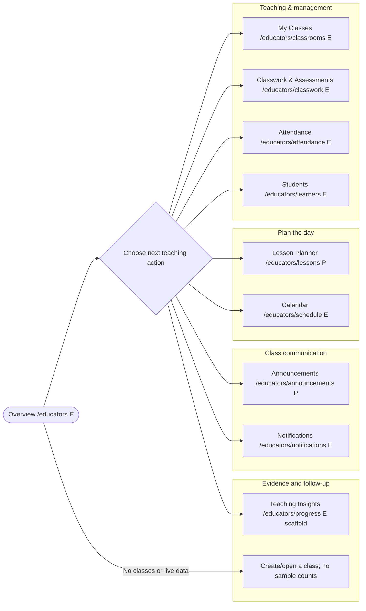

### My Classes: `/educators/classrooms` (E)

**Sections:** `ClassroomsView`, class create form, connected/demo disclosure, class cards; class detail tabs for Feed, Chat, Classwork, Materials, People, Schedule, Attendance, Progress.

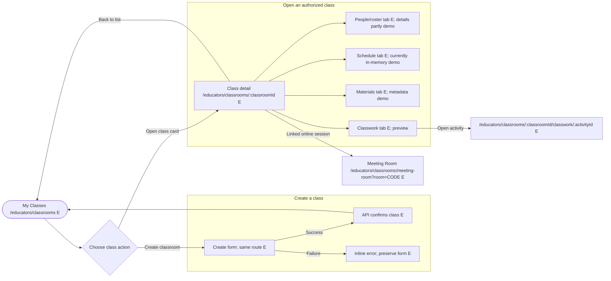

### Classwork & Assessments: `/educators/classwork` (E)

**Sections:** `EducatorClassworkView`, class/week filters, classroom/group/table/list views, activity rows, proposed creation action, and `SubmissionReviewQueue`.

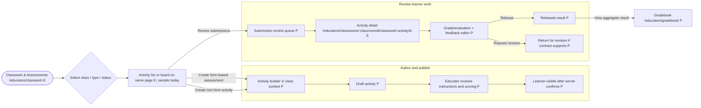

### Students: `/educators/learners` (E path; student-facing label)

**Sections:** `EducatorStudentsView`, class filter, student search, board/table/list view, and proposed student detail.

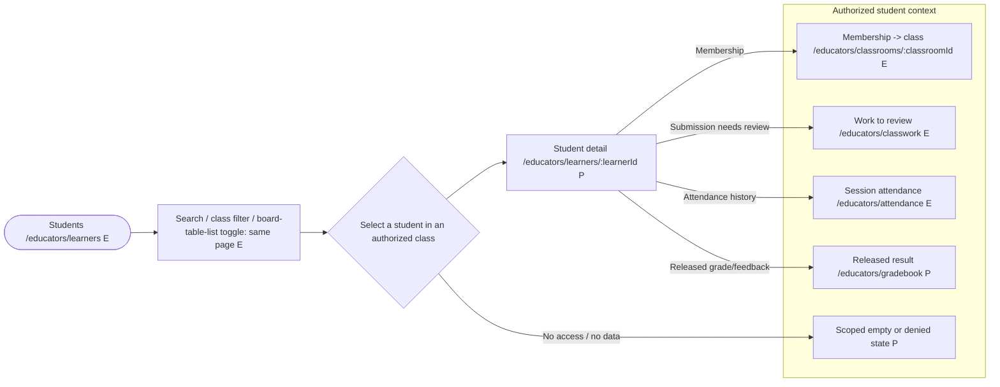

**Boundary:** Existing IDs and sample data do not provide real student details. The proposed profile must never combine cross-class records the educator is not authorized to see.

### Attendance: `/educators/attendance` (E)

**Sections:** session/date/class selector, `AttendanceRoster`, status controls, confirm action, `AttendanceHistory`, and state legend.

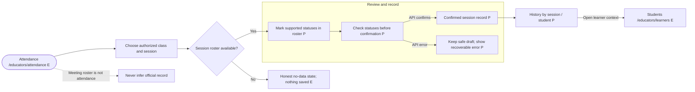

### Gradebook: `/educators/gradebook` (P)

**Sections:** class/term selector (only if supported), `GradebookGrid`, result detail, draft/released filters, and authorized export if later approved.

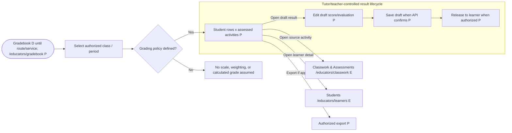

### Meeting Room: `/educators/classrooms/meeting-room` (E)

Preserve the dashboard header/sidebar throughout category entry, lobby, and call. The shared entry offers Classroom, Tutor, and ESL choices, scoped to the viewer's existing classes and workspace. Preview classes have no live room. Connected category discovery requires backend teaching-category and linked-meeting fields; direct invites remain supported.

**Sections:** standalone lobby, connected participant grid, room controls, `MeetingChatPanel`, and `PeoplePanel`; class/session pages deep-link to the same route when a valid meeting exists.

**Current visual workflow:** School educator rooms use the same Google Meet-inspired presentation as the student workspace: dark video stage, grid/spotlight layouts, local pinning, persistent bottom media/leave controls, and optional people/chat panels. `?join=1&layout-preview=1` previews this design without connecting, requesting media, or publishing chat. Host/create/end visibility still follows existing authenticated/service state, not the educator URL. LiveKit transport and current room contracts remain in place; recording, transcription, AI summaries, and Google Meet integration are not implemented. Shared implementation lives in `components/features/meeting-room/` behind the existing route adapter.

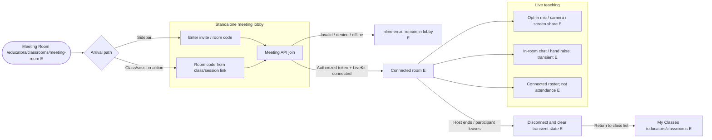

### Discussions: `/educators/communication` (E scaffold)

**Sections:** class/lesson context selection, scoped thread list, thread detail, author/time/audience, and reply composer when the discussion service exists.

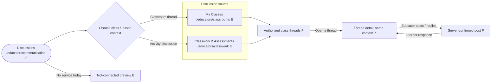

**Boundary:** Discussions are class/lesson-scoped, not a direct-message inbox. In-call Meeting Room chat is transient and does not appear as a saved thread.

### Announcements: `/educators/announcements` (P)

**Sections:** audience/class selector, announcement composer, preview, draft/published list, and delivery status only if the service confirms it.

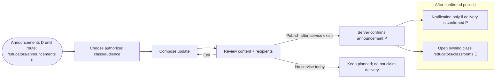

### Notifications: `/educators/notifications` (E scaffold)

**Sections:** service-backed event list, source/audience label, read state only if supported, and destination link.

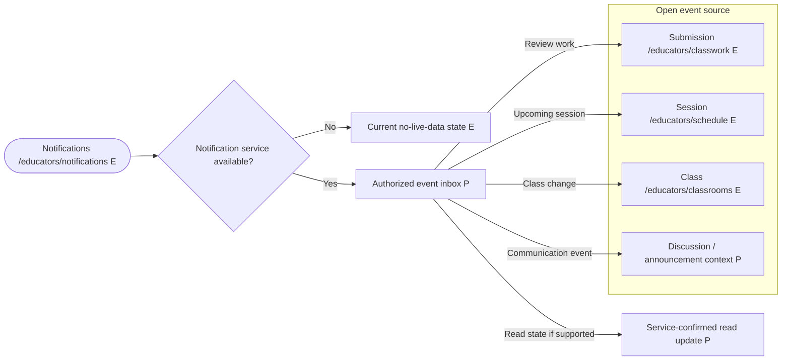

**Boundary:** Notifications link back to authoritative records and must not leak private student feedback or grades to unauthorized viewers/previews.

### Lesson Planner: `/educators/lessons` (P)

**Sections:** class selector, lesson list/calendar view, reusable lesson objectives/agenda, materials/activity linking, and session/meeting details.

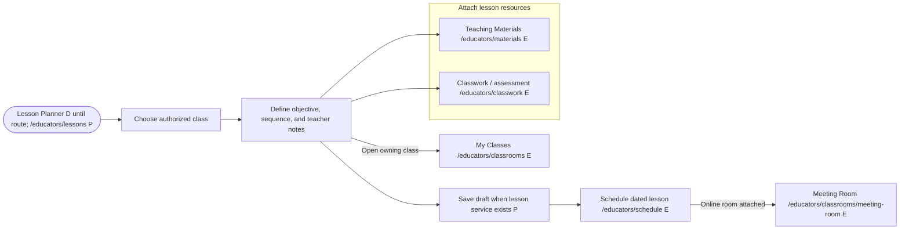

**Boundary:** A reusable plan differs from a dated session. Do not create two independent schedule sources or assume curriculum fields/lesson persistence.

### Calendar & Schedule: `/educators/schedule` (E scaffold)

**Sections:** `CalendarGrid`, day agenda, event-type filter, event detail, and event actions scoped to the event's owner/class.

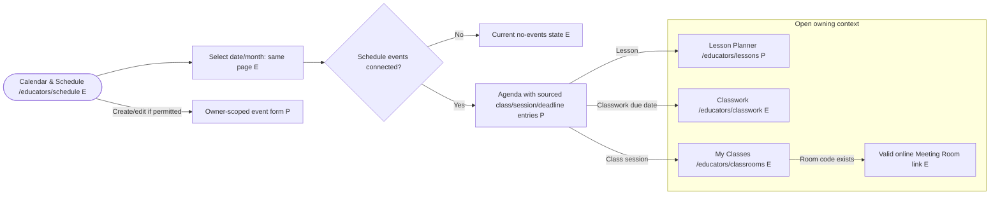

**Boundary:** Define timezone, recurrence, daylight-saving, cancellation, and reminder behavior before event mutation or sync.

### Teaching Materials: `/educators/materials` (E context selector)

**Sections:** resource source/context picker, class/topic/lesson library, search/type filter, resource detail/attachment, and upload only after storage contracts exist.

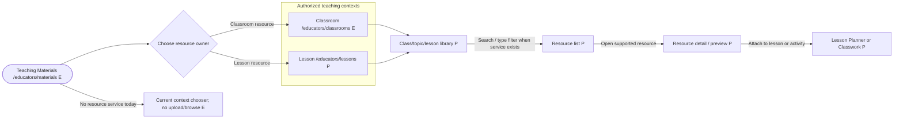

**Boundary:** Keep private teacher drafts separate from learner-visible shared resources and student submissions. File types, sizes, previews, and sharing rules come from service contracts.

### AI Form Assistant: `/educators/ai-assistant` (E scaffold)

**Sections:** target class/activity, teacher-provided topic/objective/criteria, question-type/difficulty choices, generated draft workspace, review controls, and handoff to assessment builder.

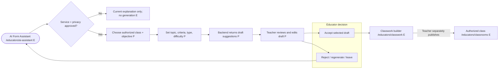

**Boundary:** The assistant never silently publishes, assigns, messages a learner, alters a score, or finalizes a grade. Do not call an AI provider from the browser.

### Teaching Insights: `/educators/progress` (E generic scaffold)

**Sections:** authorized class/date-range selector, sourced metrics, textual summary, detail links, and report export only after its contract is approved.

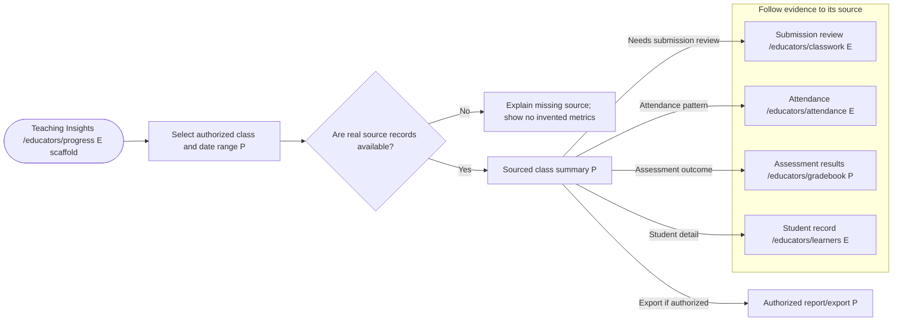

**Boundary:** Show source and date range for every number. Insights are decision support, not diagnosis, official grades, or automated “at risk” labels.

### Profile & Settings: `/educators/settings` (P)

**Sections:** server-backed educator profile, supported preferences, notification settings if available, and account actions. Keep sign-out in the shared header.

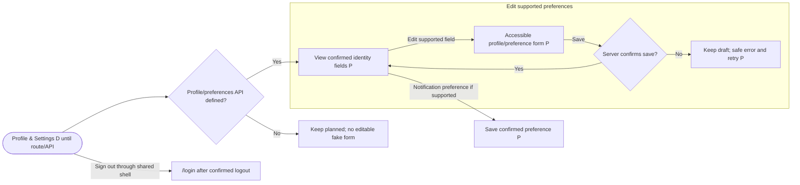

### Cross-page navigation and record-state rules

- A class card opens its authorized class detail; a lesson, activity, attendance record, or grade deep link retains its owning class context.
- A dialog save, tab switch, filter, or board/table/list toggle stays on the current route unless a flowchart names a destination.
- A planned/disabled sidebar item has no `href`, is excluded from header search, and cannot navigate to an unregistered route. When its route is implemented, add it to `src/main.tsx` and navigation together.
- Every mutation has pending, confirmed success, and recoverable failure states. Do not show success for create/publish/record/release/notification actions until the service confirms them.
- Loading, empty, filter-empty, unavailable, error, and permission-denied states are distinct. Never use sample data as live values or as a permanent empty state.

## Current application and service map

| Area | Current source | Verified state |
|---|---|---|
| Navigation/layout | `src/components/common/dashboard-navigation.ts`, `src/components/common/app-sidebar.tsx`, `src/pages/dashboard/layout.tsx` | Sidebar now has the educator groups in this plan. Existing routes are clickable; Gradebook, Lesson Planner, Announcements, and Profile & Settings remain disabled/planned. Header search only receives route-backed links. Nested Meeting Room is matched as the most-specific active item/title. |
| Routes | `src/main.tsx` | Educator routes exist for Overview, classwork, attendance, learners, classrooms/list/detail/activity, meeting room, and role-prefixed shared pages. No gradebook, lesson planner, announcements, or settings route exists. |
| Overview | `src/pages/dashboard/educators/index.tsx` | Teaching shortcuts and honest empty states; no dashboard query or live task counts. |
| Classes | `src/services/api/classroom.service.ts`, `src/components/features/classrooms/classroom-prototype-provider.tsx`, `classrooms-view.tsx`, `classroom-detail-view.tsx` | API list/create/join calls exist. The provider mixes connected classroom summaries with demo data; details and many classroom tabs are local in-memory prototype state. Confirm contracts and authorization before extending. |
| Classwork | `src/pages/dashboard/educators/classwork/index.tsx`; `src/components/features/classrooms/classroom-classwork-view.tsx`; `classroom-activity-view.tsx` | Cross-class weekly board and learner/classwork records are sample data. Classroom detail has an in-memory authoring/review preview. No classwork/submission service. |
| Students | `src/pages/dashboard/educators/learners/index.tsx` | Search, filters, board/table/list are driven by hard-coded sample learners; no student/roster API. |
| Attendance | `src/pages/dashboard/educators/attendance/index.tsx` | Hard-coded sample sessions/totals; disabled filters and roll call; no attendance API. |
| Gradebook/insights | `src/pages/dashboard/progress/index.tsx`, classroom progress views | Shared page is an empty explanatory scaffold; classroom grade/progress preview is in-memory. No official gradebook/progress service. |
| Meeting Room | `src/pages/dashboard/classroom/meeting-room.tsx`, `src/services/api/meeting.service.ts` | Full route, API create/join/end, and LiveKit presence/media exist. Chat/hand raises are transient. Not a record of official attendance or saved communication. |
| Planning/materials | `src/pages/dashboard/schedule/index.tsx`, `src/pages/dashboard/materials/index.tsx` | Calendar grid has no event data/persistence; materials page links to contexts but has no library/upload service. |
| Communication/notifications | `src/pages/dashboard/communication/index.tsx`, `src/pages/dashboard/notifications/index.tsx`, classroom feed/chat prototype | UI-only previews; posts/replies in prototype are not saved/delivered. Notification delivery/read state is not connected. |
| AI | `src/pages/dashboard/ai-assistant/index.tsx` | Educator-prep overview only; no generation provider/service. |
| Account/auth | auth session provider and `src/pages/dashboard/layout.tsx` | Authenticated user display and sign-out are integrated. Frontend route guard checks authentication, not classroom ownership or backend authorization. No profile/settings update API. |

The frontend service directory currently has authentication, health, classroom, and meeting services. It does not have APIs for attendance, student roster/records, classwork/submissions, gradebook, schedule, teaching materials, discussions, announcements, notifications, reports, AI, or profile updates. Backend service availability must be verified before any page is described as operational.

## Delivery roadmap

### Stage 0 — Product, data, and access contracts

- Confirm educator role and classroom ownership/membership behavior, including backend authorization and class isolation.
- Confirm supported school structure (course/subject/section/term) without forcing institution-wide administration into this scope.
- Define assessment and submission schemas/lifecycle, grading scales/weights/release/edit rules, attendance status/confirmation/audit rules, and learner-visible records.
- Define lesson/session ownership, timezone/recurrence/reminders, supported material storage/types/sharing, announcement/discussion audiences, and notification/read-state behavior.
- Define AI provider/service, privacy/data retention, educator review and publishing gates, and reporting/export authorization.
- Defer direct Messages and advanced insights/risk scoring unless separately approved.

### Stage 1 — Educator workspace and authorized classes

- Finalize grouped sidebar navigation and route-title/active/search behavior.
- Keep every new/refactored educator route folder to one thin `index.tsx` adapter; move screen components and interaction state into the feature folders mapped above. Do not make the route adapter a second page implementation.
- Ensure Overview uses real authorized class/action data or clear empty/error states.
- Connect My Classes list/create/invitation to authenticated API data; remove or clearly isolate demo class data from live data.
- Establish class-level ownership/membership checks as backend responsibilities before making any detailed record views operational.

### Stage 2 — Lesson, schedule, and materials foundation

- Define and connect class lessons/sessions, calendar events, and Teaching Materials ownership.
- Build Lesson Planner around classes and scheduled lessons; link calendar items and materials instead of duplicating them.
- Support class/lesson-level resource discovery and sharing only after storage/access contracts exist.

### Stage 3 — Classwork, submissions, and gradebook

- Wire activity creation, draft/publish, class assignment, submission receipt, review, feedback, and return/revision according to the confirmed API state model.
- Build the Gradebook as a view/control surface for official results sourced from those same assessment records; define scoring and release rules before calculations.
- Test that learner access only exposes authorized/released results and that review actions update the correct class records.

### Stage 4 — Attendance and student management

- Connect roster/membership and student details; scope every record to authorized classes.
- Implement session selection, roll call, confirmation/history, and learner-visible permitted attendance; exclude meeting-room presence from official records.
- Add staff-accessible grade/attendance summaries only where contracts permit and display provenance.

### Stage 5 — Communication and live teaching

- Add class-scoped Discussions, educator Announcements, and Notifications with confirmed save/delivery/read behavior.
- Keep Meeting Room as a separate destination using existing meeting service/LiveKit; deep-link from class sessions, but never substitute it for saved discussions or official attendance.
- Direct messages remain out of scope until an explicit separate decision and service contract.

### Stage 6 — Insights and AI assistance

- Build Teaching Insights from real authorized classwork, attendance, and grade data with transparent definitions and no unsupported student labels.
- Add AI Form Assistant to the activity-authoring workflow only after AI/privacy contracts; require explicit educator review before save/publish and prohibit autonomous grading or record mutation.
- Add exports only with authorized filter/scope and data handling rules.

### Stage 7 — Account completion and polish

- Implement Profile & Settings from a confirmed profile/preferences API.
- Keep all planned-but-unrouted destinations disabled until the route/page is registered; when a route is added, update `src/main.tsx`, the role-specific navigation entry, title/active matching, and header search together.
- Verify responsive sidebar, keyboard navigation, visible focus, screen-reader labels, loading/empty/error/permission states, and accessible data tables/charts.
- Revisit tutor/ESL variants separately so school-specific structures do not become assumptions in shared workflows.

## Acceptance criteria for this plan and eventual implementation

- Educators can follow a coherent path from class setup through lesson planning, materials, classwork, review, attendance, grade release, communication, and progress review.
- The sidebar has a single Teaching Materials destination, includes Notifications, offers Lesson Planner and Teaching Insights as distinct additions, and splits Attendance from Gradebook.
- Meeting Room remains an independent full page and can be reached from the educator sidebar as well as relevant class/session links.
- Every educator page in this blueprint has a documented content outline, component ownership/file placement, route status, UI-wrapper selection, and a click-through Mermaid flowchart.
- Each new educator route folder contains only `index.tsx`; substantive UI, form/schema, data/state, and reusable sections live in `src/components/features/`.
- Every clickable sidebar item resolves to an existing registered educator-prefixed route; future pages are noninteractive Planned entries and are omitted from header search until implemented.
- Classwork/assessment, attendance, gradebook, announcements, and insights show their owning class and record source.
- Official student data is isolated to authorized classrooms, and only appropriate roles can create or modify official records; the backend enforces authorization.
- Meeting presence/chat is never presented as official attendance or persisted class discussion.
- Direct Messages remain clearly future; contextual Discussions and Announcements are not represented as a working service until implemented.
- Demo/sample/in-memory content is never described as live or saved. Pages expose honest loading, empty, error, unavailable, and permission states.
- Grade calculation/release, attendance confirmation, notifications, uploads, exports, and AI outputs follow confirmed contracts rather than inferred behavior.
- New navigation links remain in sync with role-prefixed routes, header page titles/search, and sidebar active state. Existing student/tutor/ESL navigation remains unaffected unless separately approved.
- No new dependency, security-policy change, or backend endpoint is assumed by this product plan.

## Likely application files if implementation is separately approved

- Sidebar/configuration and layout behavior: `src/components/common/dashboard-navigation.ts`, `src/components/common/app-sidebar.tsx`, `src/pages/dashboard/layout.tsx`.
- Route map/adapters: `src/main.tsx`; existing `src/pages/dashboard/educators/{index,classwork,attendance,learners}/index.tsx`; proposed `learners/detail/index.tsx`, `gradebook/index.tsx`, `lessons/index.tsx`, `announcements/index.tsx`, and `settings/index.tsx`.
- Educator feature components: `src/components/features/educator-overview/`, `educator-classwork/`, `educator-students/`, `educator-attendance/`, `educator-gradebook/`, `educator-lessons/`, `educator-announcements/`, `educator-insights/`, and `educator-settings/`.
- Shared educator-facing route adapters: `src/pages/dashboard/classroom/`, `schedule/`, `materials/`, `communication/`, `notifications/`, `progress/`, and `ai-assistant/`; class detail, activity, and meeting adapters should become per-folder `index.tsx` only in a separately reviewed shared-route cleanup.
- Classroom domain views: `src/components/features/classrooms/`, especially classroom detail, classwork, feed, records, and prototype provider; migrate each flow to a service only when its API is confirmed.
- New API modules/types only after backend contracts are confirmed: `src/services/api/`.
- No application source, route, dependency, configuration, or backend changes are included in this planning document.
