# Owlio ESL Teacher Sidebar and Workflow Megaplan

Recommend an ESL-teacher-first navigation and complete lesson workflow that supports one-to-one and group language learning, keeps learner records and feedback properly scoped, and makes the Meeting Room the sole home for a temporary, interactive live whiteboard.

## Objective and confirmed decisions

- Deliver a product/UX proposal, a map of current ESL routes and integration status, and a detailed, backend-aware implementation roadmap.
- Focus on ESL teachers and their learners. The target workflow should support both one-to-one and group teaching when the classroom/session contract permits it, without requiring a formal school timetable or conventional grading scale.
- Keep **Meeting Room** as a distinct standalone page. The whiteboard is a live-session tool inside that page only; it is not another sidebar item, lesson-plan editor, or saved resource library.
- The first whiteboard scope is a **shared, live, temporary board** using built-in prompts/objects. The teacher presents a prompt; learners can interact by selecting, clicking, circling, or marking the relevant item (for example, identifying the circle). Do not include image/file upload or a full unrestricted canvas in the first scope.
- Whiteboard events are not persisted after the meeting; no export, replay, learner history, automatic grade, or attendance record is implied.
- Replace **Messages** with contextual **Discussions** for the first release. Direct messaging remains future until a separate product and service contract exists.
- Keep educator-only private teaching notes separate from feedback that is explicitly published to a learner.
- Treat every roadmap capability as planned until a real service/API confirms it. Do not invent roles, CEFR or other language-level taxonomies, scoring policies, file limits, notification behavior, or endpoints.

## Recommended ESL teacher sidebar

```text
Overview

TEACHING
- My Learners
- Lesson Plans
- Teaching Materials
- Activities & Assessments
- Lesson Attendance

LIVE LEARNING
- Meeting Room
- Lesson Schedule

COMMUNICATION
- Discussions
- Announcements
- Notifications

PROGRESS & AI
- Learner Progress
- Feedback & Notes
- AI Lesson Assistant

ACCOUNT
- Profile & Settings
```

### What to add or change

- Add **Lesson Attendance**. It is an educator-controlled session record and should not be inferred from LiveKit participant presence or whiteboard activity.
- Add a **Communication** group containing **Discussions**, **Announcements**, and **Notifications**. These are distinct concepts: lesson-scoped threads, educator-authored notices, and service-confirmed event updates.
- Rename **Messages** to **Discussions** for the contextual communication workflow. General one-to-one/group direct messaging should remain future, not be simulated by a lesson feed or Meeting Room chat.
- Keep **Feedback & Notes**, but separate its records by audience: private teacher notes are educator-only; learner feedback must be deliberately published and linked to the relevant learner, lesson, or activity.
- Keep **Meeting Room** as a full standalone page. Show the whiteboard only inside an active ESL meeting; do not add a Whiteboard sidebar item or persistent whiteboard page.
- Keep **Lesson Plans** and **Lesson Schedule** distinct: a plan is reusable teaching preparation; a schedule entry is a dated session with a learner/group, time, and meeting context.
- Retain **Teaching Materials** as one library destination. Make resources reusable across authorized lessons without losing ownership or visibility context.
- Use language-neutral sidebar/record labels where helpful (Learners, Lessons, Sessions, Feedback); do not assume every ESL teacher teaches a school class or uses a school grading scale.
- Do not add a separate “whiteboard assessment” or “meeting attendance” item. Board exercises are ephemeral live learning interactions, not grades, attendance, or saved assessment submissions unless a separately approved workflow says otherwise.

## End-to-end ESL educator workflow

1. Open Overview and review upcoming lessons, learner follow-ups, activity reviews, and attendance tasks from real data.
2. Create or select a learner or learning group and use only confirmed profile/level data.
3. Prepare a reusable Lesson Plan with a goal, language skill, sequence, resources, and practice activity.
4. Attach approved Teaching Materials and create an Activity or Assessment appropriate to the learner/group.
5. Schedule the lesson and connect it to the learner/group and the relevant meeting context.
6. Open the standalone Meeting Room and join/create the authorized live room.
7. During the connected ESL session, start a built-in whiteboard prompt; the learner interacts with the presented objects live. The teacher can observe, respond, clear, or reset the board. Board activity remains temporary and separate from formal records.
8. Record attendance through the approved attendance flow, not from video/room presence.
9. Review submitted activity, add private educator notes, and separately publish learner-facing feedback when ready.
10. Review progress from actual assessments and lesson records. Use AI Lesson Assistant output as a draft the teacher edits and approves.

## Page content and intended boundaries

### Overview

**Purpose:** Let the educator see what needs attention across ESL learners and lessons and move quickly into the next teaching action.

- Today/upcoming one-to-one and group lessons, with learner/group, local session time, lesson link, and a Meeting Room action only where a valid room is available.
- Action queue for activities/submissions to review, feedback awaiting publication, attendance to record, and upcoming lesson preparation, only when those records exist.
- Learner follow-up prompts based on real data (for example, a scheduled next lesson or an unreleased review), not fabricated language-level insights.
- Quick actions: add learner/group, create lesson plan, prepare activity, schedule session, open Meeting Room.
- First-run empty state that offers independent setup actions without requiring a classroom service to already contain data.
- Existing route: `/esl`. Current page shows placeholder cards for learners, coming up, and progress; no overview query is connected.

### My Learners

**Purpose:** Organize authorized learner profiles and teaching relationships for both individual and group instruction.

- Search and filter learners/groups by only supported profile fields and membership state.
- Learner detail should connect teaching goals, lesson history, assigned activities, attendance, released feedback, and progress only within the educator's authorized learning context.
- Support flexible individual/group membership where the backend defines it; keep a group and an individual learner distinguishable.
- Capture language level/framework (such as CEFR) only if selected and defined by product/API policy. Do not infer a level automatically from activity, speech, or AI output.
- Keep private educator observations out of learner-visible profile views and restrict personal/contact details according to access policy.
- Existing route: `/esl/learners` is an explanatory scaffold. It explicitly says learner profiles and language progress are not loaded; no learner/profile service exists.

### Lesson Plans

**Purpose:** Help the educator prepare reusable language-learning sessions and connect that preparation to a specific learner/group and scheduled lesson.

- A plan can organize target outcome/objective, language skill(s), prompt/activity sequence, materials, practice and review, and teacher notes.
- Possible ESL content areas include speaking/conversation, listening, reading, writing, vocabulary, grammar, and pronunciation only where the product chooses to support them.
- Allow an educator to adapt a reusable plan for an individual learner or group without changing the source plan unintentionally.
- Link a plan to a scheduled lesson, materials, and an activity when those records are available. Show draft/published status only if defined in a service contract.
- Learner proficiency/level, duration, recurrence, and curriculum alignment must be teacher-supplied or contract-defined; do not claim automated placement or standards alignment.
- Existing route: `/esl/lessons` introduces speaking/listening/reading/writing cards but states lesson plans, levels, and schedules are not connected. No lesson-plan service exists.

### Teaching Materials

**Purpose:** Maintain one contextual resource library for ESL teaching and reuse material in plans, activities, and lessons.

- Organize by teacher-owned library, learner/group, lesson/topic, and target skill as permitted by the product contract.
- Display resource name/type, language/skill context, owner, and the lesson/activity using it.
- Reuse or attach material through an explicit share action; private teacher resources should not become learner-visible by default.
- Supported uploads, file size/type, preview, external links, versioning, sharing, and deletion require confirmed storage/API policy. Do not promise them from a UI control alone.
- Existing route: `/esl/materials` is the shared context-selection page. It links into classroom/lesson contexts but there is no resource browsing or upload service.

### Activities & Assessments

**Purpose:** Create and review language practice connected to the relevant learner/group and lesson.

- Distinguish practice activities from assessment/graded work so a conversation exercise does not become an official grade by accident.
- Support contract-defined activity forms such as vocabulary/grammar practice, reading/listening comprehension, speaking prompts, writing tasks, quizzes, projects, or practical activities.
- Each activity may specify instructions, target skill, learner/group, due/session context, response type, and evaluation criteria only where confirmed.
- Review submissions and educator observations; keep a teacher's suggested evaluation distinct from a published result. Final judgments remain educator-controlled.
- Use status labels from the actual service. Do not assume quiz types, file submission rules, scoring, revision windows, or grade release behavior.
- Existing route: `/esl/classwork` is a language-activity overview and explicitly states no ESL activities/submissions are connected. Classroom prototype classwork is in-memory, shared across roles, and not saved.

### Lesson Attendance

**Purpose:** Record participation for a specific ESL session as an educator-controlled record.

- Select the learner/group and actual scheduled lesson/session; show date/time context and supported attendance states.
- Support educator roll call and, if confirmed, a learner check-in window. Keep one-to-one and group session behavior clear.
- Provide session and learner history using service-confirmed records. Attendance status values, corrections, and audit history must come from policy/API.
- LiveKit roster/presence only shows who is connected to the meeting; it must not automatically establish attendance, duration, or engagement.
- Existing route: `/esl/attendance` contains descriptive empty states for check-in and participation history; no attendance service exists.

### Meeting Room and live whiteboard

**Purpose:** Keep the live language session in a dedicated full-screen page and provide a shared visual activity only while the ESL room is connected.

**Meeting Room page**

- Keep a lobby/join state for invite/code, an active room state, reconnection/error feedback, and clean leave/end behavior.
- Preserve current opt-in microphone/camera, screen-share, chat, participant, and hand-raise behavior. These controls remain distinct from saved discussion, attendance, feedback, and learner records.
- Keep educator-only room creation/ending controlled by server-issued permission. An `/esl` route prefix or client-side role check is not authorization.
- Existing route: `/esl/classrooms/meeting-room` is currently a standalone full-screen meeting page reused across roles; it accepts an invite/code and uses existing meeting API and LiveKit connectivity.

**Whiteboard MVP scope (inside the active ESL Meeting Room only)**

- Render a “Whiteboard” tool/panel only for an authorized ESL session while connected. Do not show it in the sidebar, lesson-plan editor, generic material library, or non-ESL meetings unless separately approved.
- Start from built-in teacher-authored prompts and simple text/vector objects; do not support image/file uploads or unrestricted freehand drawing in the first version.
- A teacher can present a prompt such as “Find the circle.” Learners can click/select the target or use a simple circle/mark action. The teacher and room participants see these actions live.
- Keep teacher prompt/content separate from learner response marks. Make each learner's response identifiable using participant identity from the connected room; never rely on color alone.
- Give the teacher controls to start/replace a prompt and clear/reset the board. Learner actions must not remove the educator's prompt or alter another learner's response. Define the exact response policy and concurrent-edit behavior before coding.
- Board actions are session-only in memory and transient over the live-room channel. Clear them when the board/session ends or the participant leaves; do not persist, export, replay, grade, or add them to learner progress/attendance.
- The initial interaction should favor discrete actions (choose/select/circle/mark a built-in object), not high-frequency pointer streams. Keyboard and touch users need an equivalent non-drag interaction.
- Give the active board enough room to be usable on desktop and mobile; offer a clear way to switch between the board and participant view without hiding connection/error state.
- Existing meeting data messages are small JSON packets for chat and hand-raise, published reliably on the `owlio-meeting` topic, validated to 2 KB, and cleared on disconnect. The current union has no board events and there is no canvas/whiteboard implementation or whiteboard dependency in `src`/`package.json`.
- Before implementation, run a transport/design spike: confirm LiveKit packet size/rate/order/reliability limits for board operations, event identity/authorization, duplicate/out-of-order handling, state snapshot/re-sync for late join/reconnect, and what happens when a publish fails. Use compact semantic events; do not broadcast screenshots or unbounded drawing data. If the existing data-packet model is not suitable, agree on a backend/realtime service before building a board that appears collaborative but is not.
- Whiteboard actions are not a formal assessment. If a teacher wants to assess or retain a response, that must be an explicit activity/submission workflow, not an automatic side effect of clicking a shape.

**Product-plan alignment:** `OWLIO_PRODUCT_PLAN.md` currently lists real-time collaborative whiteboards as a future enhancement. This request reprioritizes a constrained, session-only ESL whiteboard for this proposed workflow; update the product roadmap and backend/realtime scope only after the owner approves this priority.

### Lesson Schedule

- Show one-to-one/group lesson appointments, date/time, learner/group, plan, and an authorized meeting link where supported.
- Offer an agenda and calendar view; keep scheduled sessions separate from reusable lesson plans and assignment deadlines.
- Define timezone, recurrence, cancellation, reminder delivery, and all-day behavior before implementation. Do not assume external calendar sync.
- Existing `/esl/schedule` maps to a shared month grid with no events loaded or saved.

### Discussions

**Purpose:** Keep teacher/learner questions and replies attached to the class, group, learner, lesson, or activity they concern.

- Make context, authorship, audience, and timestamp explicit. Use appropriate thread/reply semantics and an accessible composer.
- Separate public-to-group discussion from one-to-one contextual discussion only where the backend defines visibility and membership rules.
- Direct messages are not part of this first scope. Live Meeting Room chat remains transient and room-only; do not present it as saved lesson discussion.
- Existing `/esl/communication` is a UI-only shared preview for discussions/announcements/polls; no messages are saved or delivered.

### Announcements

- Provide educator-authored notices for a class/group or learner (e.g. session change or lesson preparation) with a clear audience and destination.
- Publish, edit, schedule, retract, and notify only where the API supports each action. An announcement is not a private feedback note or direct message.
- A dedicated sidebar entry may reuse a tab in Communication initially, but its route and state must remain role-prefixed and understandable.
- Current communication page only previews the announcement category; no announcement API exists.

### Notifications

- Show confirmed invitations, upcoming sessions, new activities/materials, replies, feedback, and schedule changes with a link to the source context.
- Use read/unread state and delivery channels only when the service defines them. Protect learner details in previews; do not imply a notification was sent just because a teacher saved a page.
- Existing `/esl/notifications` is an explanatory empty state; delivery/read-state is not wired.

### Learner Progress

**Purpose:** Give the educator a transparent view of language-learning evidence over time, not an automatically assigned language level.

- Show progress by learner and skill area (speaking, listening, reading, writing, vocabulary/grammar) only when the underlying activity/rubric supports those dimensions.
- Link every result to its lesson/activity, educator criteria, date, and release state. Keep one-to-one and group progress correctly scoped.
- Do not infer CEFR/proficiency from a small sample, meeting activity, AI output, or attendance. Learner progress is not a school gradebook unless that policy is explicitly defined.
- Add accessible text summaries and meaningful no-data/error/permission states. Reports/exports need explicit authorization and format contracts.
- Existing `/esl/progress` reuses a generic page that has no classroom records loaded; no progress/reporting service exists.

### Feedback & Notes

**Purpose:** Support educator review while preventing private teacher notes from being exposed as learner feedback.

- Separate two record types and views: **Private teaching notes** (educator-only) and **Learner feedback** (draft until intentionally published).
- Link each feedback item to the correct learner/group, lesson, or activity. Show author, date, intended audience, and publication status.
- Make visibility explicit before save/publish. Do not let a note silently cross into a learner profile, class feed, progress chart, notification, or report.
- Feedback can describe language practice and next steps, but only use supported rubrics/criteria; do not turn AI suggestions into a final evaluation automatically.
- There is no dedicated ESL feedback/notes route or service. Existing in-memory classroom progress records are mock-only and must not be reused as persisted private notes.

### AI Lesson Assistant

**Purpose:** Help ESL educators prepare adaptable language-learning drafts, with educator review before use.

- Potential assistance: conversation prompts, vocabulary sets, grammar exercises, reading/listening questions, writing prompts, speaking practice, lesson sequencing, and feedback drafts.
- Teacher selects the target skill/objective and supplies allowed lesson context; generated language content remains visibly marked as draft and editable.
- Require educator review/edit/accept/reject before adding generated content to a plan/activity or publishing it to learners. No silent assignment, learner contact, final assessment, grade, or progress mutation.
- Avoid sending private learner/lesson data to an AI provider until provider, consent/privacy, data retention, and backend contracts are approved. Do not call an AI service directly from the browser.
- Existing `/esl/ai-assistant` reuses a shared educator-prep scaffold; no AI provider or generation service exists.

### Profile & Settings

- Profile name/role and sign-out are present in the dashboard shell; profile editing, ESL teaching preferences, language-level defaults, notification settings, and privacy controls need confirmed profile/preferences APIs.
- Do not infer ESL subtype or authorization from client-side onboarding selection. The registered educator identity and ESL workspace currently have a role-contract mismatch/open decision; backend authorization remains authoritative.
- No settings route or profile-update service exists.

## Route and component implementation blueprint

This is the target frontend architecture, not a claim that every route or operation exists. `E` means an existing route, `P` means a proposed route, and `D` means the sidebar item remains disabled/planned until its route and service are approved.

### Route inventory

| Sidebar destination | Route | Status and intended route behavior |
|---|---|---|
| Overview | `/esl` | E. Current ESL dashboard scaffold. |
| My Learners | `/esl/learners` | E. Current empty learner-context page. |
| Lesson Plans | `/esl/lessons` | E. Skill-category/lesson preview; plan records not connected. |
| Teaching Materials | `/esl/materials` | E. Shared material-context selector, not a library/upload service. |
| Activities & Assessments | `/esl/classwork` | E. Language activity preview; no activities/submissions service. |
| Lesson Attendance | `/esl/attendance` | E. Check-in/history preview; no attendance service. |
| Meeting Room | `/esl/classrooms/meeting-room` | E. Standalone shared LiveKit room. Whiteboard remains an in-room tool only. |
| Lesson Schedule | `/esl/schedule` | E. Shared calendar grid; no event data or persistence. |
| Discussions | `/esl/communication` | E. Shared contextual communication preview, not a saved messaging service. |
| Announcements | `/esl/announcements` | P/D. Separate ESL-prefixed page once audience/save behavior is defined. |
| Notifications | `/esl/notifications` | E. Empty inbox preview; no delivery/read-state service. |
| Learner Progress | `/esl/progress` | E. Generic progress placeholder; no ESL progress records. |
| Feedback & Notes | `/esl/feedback-notes` | P/D. Separate private educator notes from learner-visible published feedback. |
| AI Lesson Assistant | `/esl/ai-assistant` | E. Shared educator-preparation scaffold; no provider/generation service. |
| Profile & Settings | `/esl/settings` | P/D. Requires authenticated profile/preferences contract. |

Supporting class routes remain `/esl/classrooms`, `/esl/classrooms/:classroomId`, and `/esl/classrooms/:classroomId/classwork/:activityId`; keep them role-prefixed even if the top-level sidebar uses My Learners as the primary teaching hub.

### `index.tsx`-only route adapters

- Every new or refactored route folder under `src/pages/` should contain only `index.tsx`. An adapter imports one feature view and returns it; it owns no screen sections, form state, mock arrays, API requests, or feature rules.
- Register routes in `src/main.tsx`; keep ESL URLs under `/esl`. The route prefix is workspace presentation only, not authorization.
- Current ESL folders `esl/`, `esl/learners/`, `esl/lessons/`, `esl/classwork/`, and `esl/attendance/` already have `index.tsx` adapters.
- Proposed route folders: `esl/announcements/index.tsx`, `esl/feedback-notes/index.tsx`, and `esl/settings/index.tsx`. Add each route in `main.tsx` only after its feature contract is approved.
- Shared classroom exceptions are `src/pages/dashboard/classroom/detail.tsx`, `activity.tsx`, `meeting-room.tsx`, and `meeting-room.lazy.tsx`. A separately approved shared-route cleanup can move these to `classroom/detail/index.tsx`, `classroom/activity/index.tsx`, and `classroom/meeting-room/index.tsx`, preserving their role-prefixed URLs and lazy loading.
- `src/pages/dashboard/layout.tsx` is a shared route layout, not an ESL screen. Move it under `src/components/layouts/` only as a separately approved cross-app cleanup; root `src/pages/App.tsx` is also outside this tutor/ESL scope.
- Shared ESL screens under `schedule`, `materials`, `communication`, `notifications`, `progress`, and `ai-assistant` should delegate to role-aware feature views. Reuse the shared destination where the workflow genuinely matches, but do not force ESL-specific learner language, session format, or feedback into a school-only design.
- Use the local Base UI-based wrappers as used by neighboring code. For Router links use `Button render={<Link to="..." />}`; do not assume Radix `asChild`. The local `Tabs` API uses `value` and `onValueChange`.

### File placement and component ownership

The tree shows likely future file locations, not files to create in this plan change. `(E)` means an existing page/view; `(P)` means proposed.

```text
src/pages/dashboard/esl/
  index.tsx                             # E: route adapter -> EslOverviewView
  learners/index.tsx                    # E: route adapter -> EslLearnersView
  lessons/index.tsx                     # E: route adapter -> EslLessonPlansView
  classwork/index.tsx                   # E: route adapter -> EslActivitiesView
  attendance/index.tsx                  # E: route adapter -> EslAttendanceView
  announcements/index.tsx               # P: route adapter -> EslAnnouncementsView
  feedback-notes/index.tsx              # P: route adapter -> EslFeedbackNotesView
  settings/index.tsx                    # P: route adapter -> EslSettingsView
src/pages/dashboard/classroom/
  index.tsx                             # E: shared class list adapter
  detail/index.tsx                      # P migration of current detail.tsx adapter
  activity/index.tsx                    # P migration of current activity.tsx adapter
  meeting-room/index.tsx                # P migration/lazy adapter for current room page

src/components/features/
  esl-teaching/
    overview/esl-overview-view.tsx              # P: dashboard composition
    learners/esl-learners-view.tsx              # P: learner/group list
    learners/learner-profile-view.tsx            # P: one authorized learner's context
    lesson-plans/esl-lesson-plans-view.tsx        # P: reusable plans
    lesson-plans/lesson-plan-editor.tsx           # P
    materials/esl-materials-view.tsx              # P: role-aware library view
    activities/esl-activities-view.tsx            # P: practice/evaluation lists
    activities/activity-builder.tsx               # P
    activities/submission-review-queue.tsx        # P
    attendance/esl-attendance-view.tsx             # P
    attendance/lesson-session-picker.tsx           # P
    attendance/attendance-roster.tsx               # P
    meeting-room/esl-whiteboard.tsx                # P: temporary in-room board
    meeting-room/whiteboard-prompt-builder.tsx     # P: built-in text/vector prompts
    meeting-room/whiteboard-stage.tsx              # P: synchronized learner responses
    schedule/esl-schedule-view.tsx                 # P
    communication/discussions-view.tsx             # P
    communication/announcements-view.tsx           # P
    notifications/esl-notifications-view.tsx       # P
    progress/esl-learner-progress-view.tsx          # P
    feedback-notes/esl-feedback-notes-view.tsx      # P: private and published records
    ai-assistant/esl-ai-lesson-assistant-view.tsx   # P: educator-reviewed drafts
    settings/esl-settings-view.tsx                  # P
  classrooms/                                      # E: shared classroom/detail/activity views
  meeting-room/                                    # E/P: extract shared LiveKit page as a feature view
  ui/                                              # E: domain-neutral wrappers
src/components/layouts/
  platform-layout.tsx                     # P: move shared dashboard layout in separate cleanup
```

### Checked-in shadcn-style component mapping

Use the actual wrappers under `src/components/ui/`; they are project-owned Base UI wrappers, not raw Radix components. This table suggests building blocks, not a requirement to use every item on every page.

| ESL page | Suitable checked-in wrappers |
|---|---|
| Overview | `Card`, `Badge`, `Button`, `Empty`, `Skeleton`, `Alert`; `Progress` only when sourced data is real. |
| My Learners | `Input`, `Select`, `Tabs`, `Card`, `Avatar`, `Badge`, `Table`, `Empty`, `Skeleton`, `Alert`. |
| Lesson Plans | `Tabs`, `Card`, `Field`, `Input`, `Textarea`, `Select`, `Button`, `Badge`, `Dialog`, `Empty`, `Skeleton`. |
| Teaching Materials | `Card`, `Tabs`, `Input`, `Select`, `Badge`, `Attachment`, `Empty`, `Skeleton`, `Alert`; upload only after storage contract. |
| Activities & Assessments | `Tabs`, `Card`, `Table`, `Field`, `Input`, `Textarea`, `Select`, `Checkbox`, `Dialog`, `Badge`, `Alert`, `Empty`, `Skeleton`. |
| Lesson Attendance | `Select`, `Table`, `Checkbox`, `Card`, `Badge`, `Alert`, `Empty`, `Skeleton`, `Collapsible`, `Button`. |
| Meeting Room | Existing custom LiveKit controls plus `Button`, `Drawer`, `ScrollArea`, `Alert`, `Badge`; board objects should be keyboard/touch accessible. |
| ESL Whiteboard | `Card`, `Button`, `Tabs`, `Dialog`, `Alert`, `Badge`; use semantic SVG/vector targets for built-in prompts rather than a new component dependency unless approved. |
| Lesson Schedule | `Card`, `Button`, `Select`, `Dialog` or `Drawer`, `Badge`, `Empty`; no Popover wrapper exists in the current UI folder. |
| Discussions | `Tabs`, `Card`, `Badge`, `Textarea`, `Field`, `Button`, `ScrollArea`, `Empty`, `Alert`. |
| Announcements | `Card`, `Field`, `Input`, `Textarea`, `Select`, `Button`, `Badge`, `Dialog`, `Alert`, `Empty`. |
| Notifications | `Card`, `Tabs`, `Badge`, `Button`, `Empty`, `Skeleton`, `Alert`. |
| Learner Progress | `Card`, `Tabs`, `Table`, `Progress`, `Badge`, `Empty`, `Skeleton`, `Alert`; include text summaries for charts. |
| Feedback & Notes | `Tabs`, `Card`, `Field`, `Textarea`, `Input`, `Badge`, `Button`, `Dialog`, `Alert`, `Empty`; private notes and published feedback are separate record types. |
| AI Lesson Assistant | `Card`, `Field`, `Textarea`, `Input`, `Select`, `Button`, `Alert`, `Badge`, `Skeleton`, `Dialog` for review. |
| Profile & Settings | `Card`, `Field`, `Input`, `Switch`, `Button`, `Alert`; editable only for API-supported fields. |

Use React Hook Form/Zod for complex forms where consistent with neighboring code, with schemas beside the feature. No new UI dependency is required by this plan.

## ESL page click-through flowcharts

Each chart begins at a sidebar destination. `E` means an existing route, `P` a proposed route/action, and `D` a disabled/planned item. Mermaid subgraphs group related branches; open this Markdown in a Mermaid-enabled preview to see rendered diagrams instead of source. Same-page tabs/dialogs are labeled as such. The charts describe target navigation and do not imply an API exists.

### Overview: `/esl` (E)

**Sections:** learner/session summary, coming-up list, preparation/review queue, recent lesson activity, and quick actions. Populate counts only from authorized, real records.

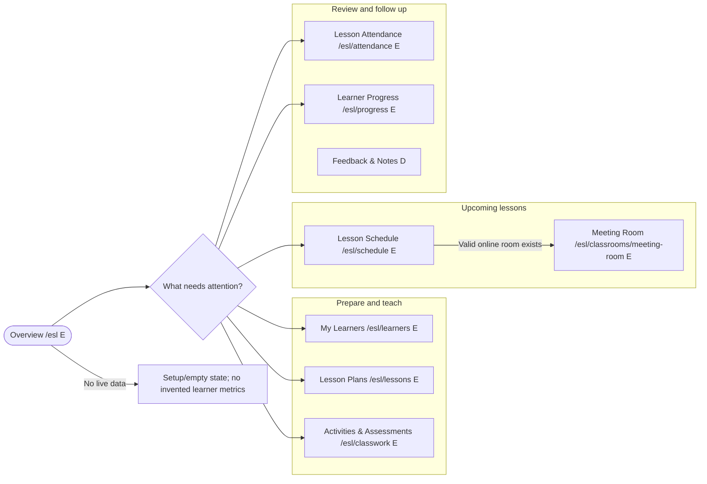

### My Learners: `/esl/learners` (E)

**Sections:** learner/group search, enrollment/context filter, learner cards/list, and a detail view with approved profile/goal/lesson links.

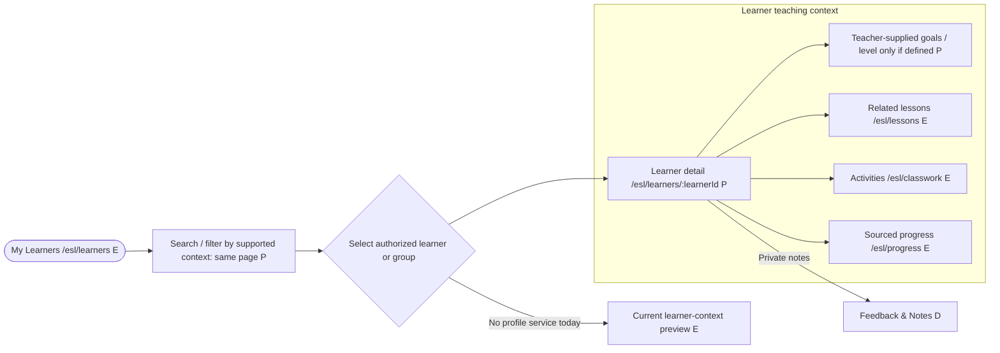

**Boundary:** A client-side learner ID or `/esl` prefix does not authorize the profile. Do not infer CEFR/proficiency or mix one learner's records into a group view.

### Lesson Plans: `/esl/lessons` (E)

**Sections:** plan library, learner/group selector, goal/skill context, reusable lesson sequence, linked materials/activity, and save/publish state.

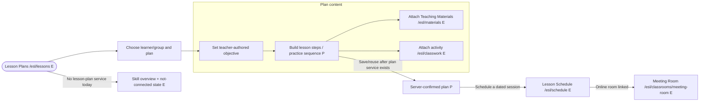

### Teaching Materials: `/esl/materials` (E context chooser)

**Sections:** teacher-owned library, class/lesson/learner/group context, skill/topic filters, resource list, detail/preview, and explicit share/attach actions.

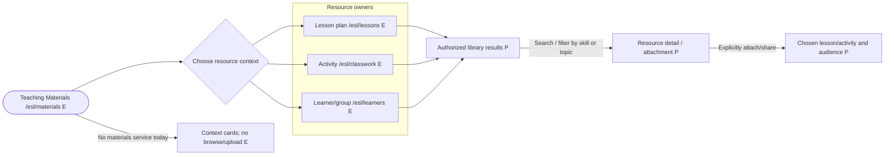

**Boundary:** Private tutor/educator resources stay private until explicit sharing. Supported file formats, upload limits, preview, storage, and external integrations require service contracts.

### Activities & Assessments: `/esl/classwork` (E)

**Sections:** practice/activity list, learner/group and lesson filters, activity builder, learner submissions/responses, educator review, and feedback publication.

```mermaid
flowchart LR
  ACT(["Activities & Assessments /esl/classwork E"]) --> CONTEXT["Choose learner/group + lesson context P"]
  subgraph BUILD["Create language practice"]
    TYPE{"Choose supported activity type"}
    FORM["Vocabulary / grammar / reading / listening / speaking / writing"]
    CRITERIA["Set teacher-authored instructions and criteria P"]
    DRAFT["Review draft before assigning P"]
    TYPE --> FORM --> CRITERIA --> DRAFT
  end
  CONTEXT --> TYPE
  DRAFT -->|"Publish after service confirms"| LEARNER["Learner receives assigned activity P"]
  LEARNER -->|"Learner submits supported response"| REVIEW["Submission review queue P"]
  REVIEW -->|"Tutor/teacher evaluates"| FEEDBACK["Private draft or explicit published feedback"]
  FEEDBACK -->|"Published record"| PROGRESS["Learner Progress /esl/progress E"]
  ACT -->|"No activity/submission service"| EMPTY["Current activity-category preview E"]
```

**Boundary:** Activity types, file/link response types, statuses, assessment scales, and feedback release rules must follow the API contract. Whiteboard interaction is a live practice action, not a submission or grade.

### Lesson Attendance: `/esl/attendance` (E)

**Sections:** session/lesson selector, learner/group roster, allowed status controls, confirmation state, and history by session/learner.

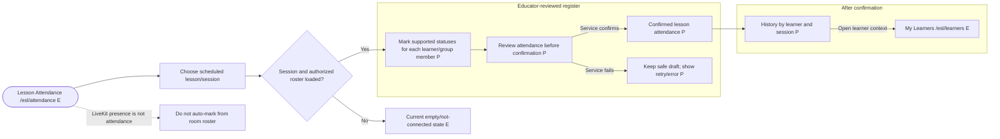

### Meeting Room and temporary ESL whiteboard: `/esl/classrooms/meeting-room` (E)

**Sections:** standalone lobby, LiveKit stage, participant/chat panels, existing controls, and an ESL-only whiteboard stage available only after an authorized room is connected.

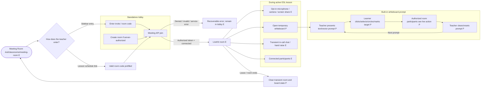

**Boundary:** Whiteboard input stays temporary and separate from submission, assessment, attendance, feedback, and progress. Room membership/host authority must come from server-issued authorization, not the `/esl` route.

### Lesson Schedule: `/esl/schedule` (E scaffold)

**Sections:** calendar grid, selected-day agenda, learner/group selector, lesson detail, and Meeting Room action only for a valid online session.

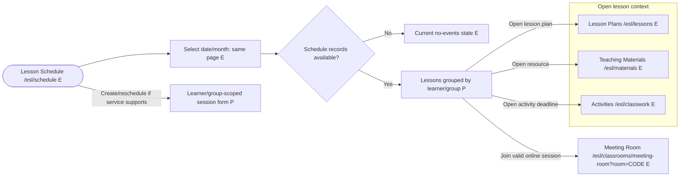

**Boundary:** Confirm timezone, recurrence, cancellation, reminders, and online/in-person/hybrid modes before event mutations or external calendar sync.

### Discussions: `/esl/communication` (E preview)

**Sections:** context selector, learner/group/lesson thread list, author/audience metadata, thread detail, and reply composer after a communications service exists.

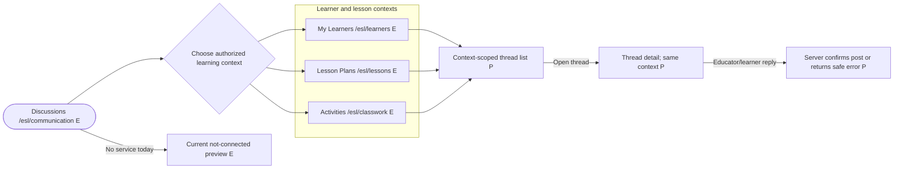

**Boundary:** Direct messaging is not in the first scope. In-call chat remains transient to the Meeting Room and must not appear as a saved discussion or private Session Note.

### Announcements: `/esl/announcements` (P)

**Sections:** learner/group audience picker, composer, preview, published/draft list, and notification status only if confirmed by services.

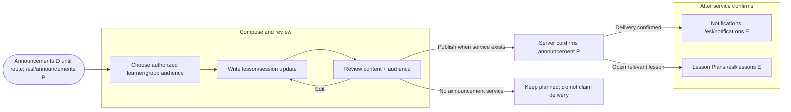

### Notifications: `/esl/notifications` (E scaffold)

**Sections:** confirmed event inbox, category/read filters if supported, safe event preview, and a link to the originating lesson/learner/activity.

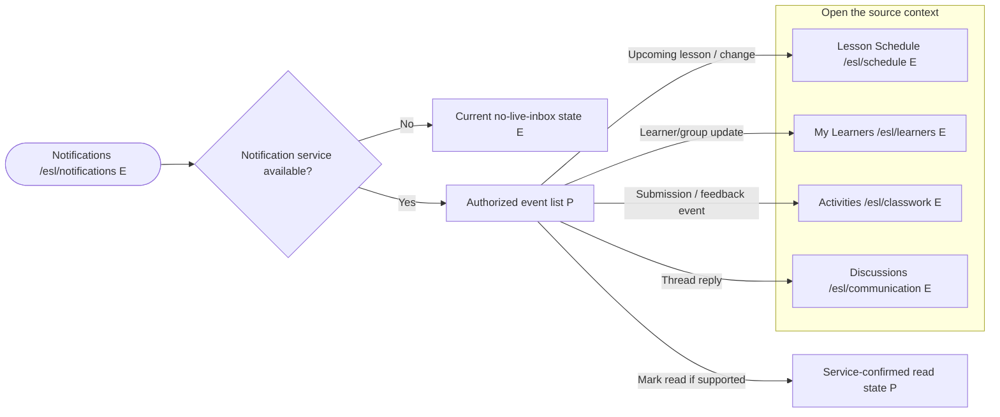

**Boundary:** Do not expose private notes or unpublished feedback in notification previews; read/delivery state must come from the notification service.

### Learner Progress: `/esl/progress` (E scaffold)

**Sections:** learner/group selector, date range, evidence by supported language skill/objective, session/activity history, and released feedback links.

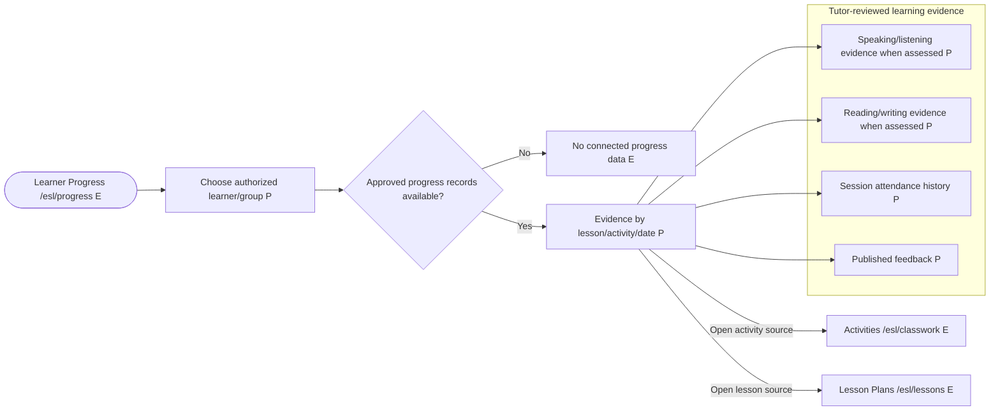

**Boundary:** Each progress value identifies its source/date/criteria. Do not infer CEFR/proficiency, mastery, or a school grade from sparse activity, attendance, AI output, or in-call whiteboard actions.

### Feedback & Notes: `/esl/feedback-notes` (P)

**Sections:** separate `PrivateTeachingNotes` and `LearnerFeedback` views, learner/group and lesson filters, draft/published state, and explicit publish action.

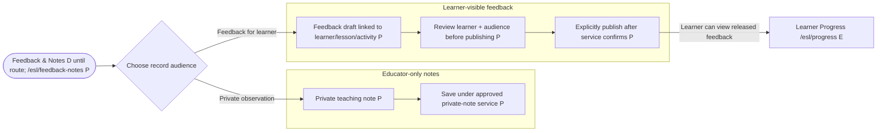

**Boundary:** Private notes never leak into profiles, discussions, notifications, progress, or reports. Published feedback is a distinct record with an explicit audience and release state.

### AI Lesson Assistant: `/esl/ai-assistant` (E scaffold)

**Sections:** teacher-selected skill/objective and learner context, prompt form, draft response, edit/reject/regenerate controls, and explicit handoff to a plan/activity.

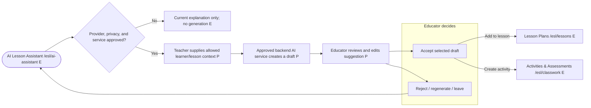

**Boundary:** AI never silently publishes, evaluates a learner, contacts a learner, assigns a final level, or changes attendance/progress. No private learner/session data is sent directly from the browser.

### Profile & Settings: `/esl/settings` (P)

**Sections:** confirmed identity/profile fields, supported preferences, notification/privacy settings only when backed by a profile API, and account actions.

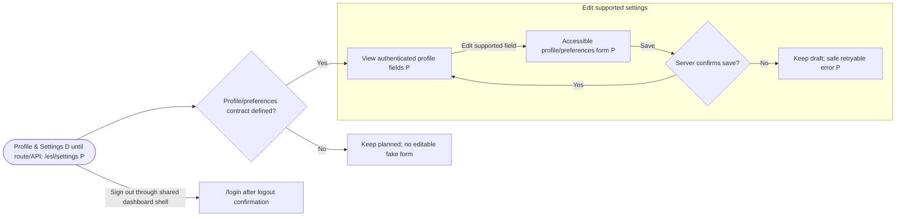

**Boundary:** Do not infer ESL role/subtype from a client route or local onboarding choice; profile authorization is server-owned.

### Cross-page navigation and record-state rules

- Learner, group, lesson, activity, attendance, note, feedback, and resource links retain their owning context and audience.
- Tabs, filters, prompts, and dialogs stay on their current URL unless a flowchart names a destination. Proposed routes are not implicitly registered.
- Every create/save/publish/check-in/notification action has pending, confirmed-success, and recoverable-error states. Do not claim success until a service confirms it.
- Loading, empty, filtered-empty, unavailable, error, and permission-denied states are distinct. Sample classroom/session records stay labeled as demo.
- The whiteboard is visible only in an authorized, connected ESL Meeting Room; live selections clear on room/board end and never alter classwork, attendance, feedback, or progress.

## Current route, component, and data-flow map

| Area | Current source | Verified implementation status |
|---|---|---|
| ESL sidebar | `src/components/common/dashboard-navigation.ts`; renderer `src/components/common/app-sidebar.tsx` | ESL now has the grouped sidebar described here. Existing routes are linked; Announcements, Feedback & Notes, and Profile & Settings remain disabled/planned until their route/service exists. Header search contains route-backed items only. |
| Routes/layout | `src/main.tsx`; `src/pages/dashboard/layout.tsx` | ESL routes are role-prefixed and use the shared layout. Existing `/esl/classrooms/meeting-room` is a full-screen route. Role prefixes are presentation only; `RequireAuth` does not replace backend role/resource authorization. |
| Overview | `src/pages/dashboard/esl/index.tsx` | Placeholder cards for learner, upcoming, and progress sections; no live dashboard query. |
| Learners | `src/pages/dashboard/esl/learners/index.tsx` | Explains desired goal/activity/feedback areas but no learner profile or language-progress data is loaded. |
| Lesson Plans | `src/pages/dashboard/esl/lessons/index.tsx` | Skill-category copy and an empty-state message; no lesson plan, learner level, or schedule service. |
| Activities | `src/pages/dashboard/esl/classwork/index.tsx` | Activity type preview and empty feedback copy; no ESL activity/submission API. |
| Attendance | `src/pages/dashboard/esl/attendance/index.tsx` | Empty check-in/history preview; no attendance service. |
| Classroom details | `src/components/features/classrooms/classroom-detail-view.tsx`, `classroom-records-view.tsx`, `classroom-prototype-provider.tsx` | Shared class shell. The service provides classroom list/create/join; provider adds initial sample classes and holds details, materials, sessions, posts, chat, attendance, activities, submissions, and progress in memory. An ESL sample class exists, but is not live data. |
| Meeting Room | `src/pages/dashboard/classroom/meeting-room.tsx`; `src/services/api/meeting.service.ts` | Full-screen LiveKit page with create/join/end API, video/audio, screen share, transient chat/hand raise, participant list and opt-in media. No whiteboard component/events/service are present. The page is shared across role-prefixed routes. |
| Planning/materials | `src/pages/dashboard/schedule/index.tsx`, `src/pages/dashboard/materials/index.tsx` | Shared calendar grid and resource-context selection only; no event or material API/persistence. |
| Communication/notifications | `src/pages/dashboard/communication/index.tsx`, `src/pages/dashboard/notifications/index.tsx` | UI-only preview/empty state. No announcement/discussion/notification service or delivery state. |
| Progress/AI | `src/pages/dashboard/progress/index.tsx`, `src/pages/dashboard/ai-assistant/index.tsx` | Generic progress distinction and educator AI copy; no ESL-specific records or AI generation API. |
| API services | `src/services/api/` | Current service files cover auth, health, classroom header operations, and meetings. No learner, lesson, material, activity, submission, attendance, communication, feedback, progress, notification, profile, AI, or whiteboard API exists. |

## Delivery roadmap

### Stage 0 — Confirm ESL product and realtime contracts

- Confirm account/role mapping for ESL teachers and backend authority for room/learner permissions.
- Define learner/group model, optional proficiency framework, lesson/plan records, skill/objective taxonomy, activity/submission state, feedback visibility, private note retention, attendance values, and report scope.
- Whiteboard: approve the constrained temporary ESL-only feature and its exact interaction model (teacher-owned prompt, learner select/circle/mark), clear/reset authority, participant attribution, allowed concurrency, and no persistence/export.
- Run a LiveKit transport spike for compact board event delivery, authorization, ordering/deduplication, rate/payload limits, late join/reconnect resynchronization, and failed-publish UI. If the existing LiveKit data-packet channel is unsuitable, stop and define an approved realtime service before building.
- Confirm calendar timezone/recurrence/reminders, material upload rules, communication audience/delivery, and AI provider/privacy before implementation.

### Stage 1 - ESL workspace navigation and learner/lesson foundation

- Map the proposed ESL teacher sidebar to role-prefixed routes; align sidebar active state, header title, workspace search, and notification shortcut.
- Keep each new/refactored ESL route folder to a thin `index.tsx` adapter; implement screens and state in the `esl-teaching` feature modules mapped above.
- Improve the Overview and My Learners destinations with real service-backed data or honest first-run/loading/error/permission states.
- Establish learner/group and lesson plan services before activities are linked to them. Avoid deriving ESL proficiency from unapproved client-side assumptions.

### Stage 2 — Lesson preparation, schedule, and materials

- Connect reusable Lesson Plans, session scheduling, and a single Teaching Materials library.
- Link each dated Lesson Schedule entry to the right learner/group, plan, and authorized meeting context.
- Define timezone, recurrence, file/storage and material-sharing behavior before offering save/upload controls.

### Stage 3 — Live ESL Meeting Room and interactive whiteboard

- Preserve existing LiveKit audio/video/room controls and implement the whiteboard as a separate ESL-only in-room component, visible only in a connected authorized session.
- Deliver the built-in prompt/object MVP: educator prompt, learner select/circle/mark, synchronized participant view, teacher clear/reset, and responsive/accessibility behavior.
- Keep board content temporary and clear it on session/board end. Do not connect board responses to attendance, grades, learner progress, reports, or AI.
- Verify with two or more clients, multiple participants acting at once, reconnect/late join, failed publish, malformed/oversized/unauthorized packets, room isolation, and disconnect cleanup. If no LiveKit service is available, report transport behavior as unverified rather than claiming collaboration works.

### Stage 4 — Activities, assessment, attendance, and feedback

- Connect ESL activity authoring and learner response/review using the approved activity and submission lifecycle.
- Implement educator-controlled lesson attendance independent of meeting presence.
- Implement private teaching notes separately from learner-visible draft/published feedback.
- Ensure all learner records are access-scoped and that publishing feedback has explicit audience confirmation.

### Stage 5 — Communication and progress

- Add lesson/learner/group-scoped Discussions, Announcements, and Notifications only against confirmed audience, delivery, and read-state APIs.
- Build Learner Progress from actual educator-authored/approved activity records, with sources, dates, skill criteria, and no inferred proficiency labels.
- Add reports/exports only after permission and data-handling contracts are approved.

### Stage 6 — AI Lesson Assistant and account settings

- Add a service-backed ESL assistant for reviewable lesson/activity drafts after privacy/provider policy is approved.
- Add profile/settings only when authenticated profile and preferences APIs define supported fields and persistence.

## Acceptance criteria for this plan and later implementation

- The educator can follow a coherent ESL path: learner/group → lesson plan → materials/activity → scheduled lesson → live meeting → review/attendance/feedback → evidence-based progress.
- The sidebar contains Lesson Attendance, Discussions, Announcements, and Notifications; direct Messages are not presented as working until separately implemented.
- Every sidebar page in this blueprint has a route status, feature-component/file map, checked-in UI-wrapper choices, and a branching Mermaid click-flow diagram.
- Every new/refactored ESL route directory contains only `index.tsx`; substantive UI, forms, schemas, state, and data logic live under `src/components/features/esl-teaching/` or the appropriate shared feature module.
- All Mermaid diagrams use a visual left-to-right layout with grouped branches, not a table. Each clickable target is an existing registered route or marked proposed/disabled.
- Lesson Plans and Lesson Schedule are clearly different: reusable instructional preparation versus dated sessions.
- Meeting Room remains a separate page; the whiteboard exists only inside an active authorized ESL Meeting Room and never appears as a separate page/sidebar destination.
- In the whiteboard MVP, teacher-authored built-in prompt objects are distinct from learner responses; at least one learner can select/circle/mark a target and all permitted connected participants can see the live action.
- Board state is temporary, room-scoped, not persisted, and cleared on end/leave. It cannot mutate attendance, grades, submissions, feedback, or learner progress.
- Board identity/permissions derive from the connected authorized room; route prefixes and client-side visibility do not authorize participants.
- Board operations are validated, size/rate bounded, deduplicated/ordered or otherwise reconciled, and recoverable from reconnection according to the approved transport design. No screenshots or unbounded freehand events are broadcast in the initial scope.
- Keyboard/touch users can interact with prompts without relying solely on drag or color; board and meeting controls remain accessible and responsive.
- Private educator notes and learner-visible published feedback are separate records/views with explicit visibility.
- Meeting chat/hand-raise/participant presence remain distinct from saved communication and official attendance.
- Sample/demo/in-memory data is clearly labeled; loading, empty, error, unavailable, and permission-denied states are designed for service-backed workflows.
- No new dependency, unconfirmed file behavior, AI provider, role, endpoint, or data-retention promise is introduced by assumption.

## Likely application files if implementation is separately approved

- Role navigation and page chrome: `src/components/common/dashboard-navigation.ts`, `src/components/common/app-sidebar.tsx`, and `src/pages/dashboard/layout.tsx`.
- Route registration/adapters: `src/main.tsx`; existing `src/pages/dashboard/esl/{index,learners,lessons,classwork,attendance}/index.tsx`; proposed `announcements/index.tsx`, `feedback-notes/index.tsx`, and `settings/index.tsx`.
- ESL feature components: `src/components/features/esl-teaching/{overview,learners,lesson-plans,materials,activities,attendance,meeting-room,schedule,communication,notifications,progress,feedback-notes,ai-assistant,settings}/`.
- Shared role-prefixed adapters: `src/pages/dashboard/{schedule,materials,communication,notifications,progress,ai-assistant}/index.tsx`; extract role-aware view components and preserve all existing role contexts.
- Meeting Room and whiteboard: keep the route at `/esl/classrooms/meeting-room`; target a thin `src/pages/dashboard/classroom/meeting-room/index.tsx` adapter and `src/components/features/esl-teaching/meeting-room/` board components inside the shared meeting page. Do not add a whiteboard route or modify other roles' meeting experience without approval.
- Shared class flow/data: `src/components/features/classrooms/classroom-detail-view.tsx`, `classroom-records-view.tsx`, `classroom-prototype-context.ts`, `classroom-prototype-provider.tsx`, and `src/services/api/classroom.service.ts` only as confirmed APIs replace prototype data.
- API integration: add/extend `src/services/api/meeting.service.ts` or a focused realtime service only after transport, authorization, payload, and privacy contracts are approved. Do not expose short-lived meeting credentials or persist them in browser storage.
- No application source, dependency, route, or backend changes are included in this planning document.
