# Owlio Student Sidebar and Workflow Megaplan

Recommend a student-first navigation and page-content model that preserves Owlio's independent-learning promise, separates peer and official classroom records, maps the proposal to the current frontend, and sequences future work by backend readiness.

This is the detailed Student workspace specification linked from the [Owlio Product Plan](OWLIO_PRODUCT_PLAN.md#4-four-role-workspaces-and-their-connected-learning-contexts). Use the product plan for shared capabilities, cross-role ownership boundaries, and delivery dependencies; use this document for student navigation, page requirements, click flows, and acceptance criteria. Current source, runtime flags, and confirmed backend contracts determine implementation status; the current-state snapshots below must be rechecked before implementation.

## Objective and agreed scope

- Deliver a product/UX proposal plus a current-state map and staged roadmap for the student workspace and shared experiences students use.
- Use the full Owlio product vision as the target, but clearly distinguish shipped integrations, local/demo prototypes, and future product capabilities.
- Keep the work student-first. Include shared classroom, calendar, meeting, communication, materials, notification, and progress behavior only where it affects the student journey.
- Treat general direct Messages as a future capability, not a working destination in the first student navigation.
- This is a planning deliverable, not permission to edit application source. No API routes, permissions, data behavior, dependencies, or backend contracts are to be invented.

## Recommendation

Keep the requested high-level sections, but make the student navigation express three different contexts: personal learning, educator-led classes, and peer collaboration. Do not put every feature in the sidebar merely because it exists in the product vision.

```text
Overview

LEARNING
- My Learning
- My Classes
- Study Library
- Study Spaces

COMMUNICATION
- Meeting Room
- Discussions
- Notifications

ACADEMIC
- Calendar & Schedule
- Tasks & Assessments
- Progress & Grades

TOOLS & SUPPORT
- AI Study Assistant
- Help & Support

ACCOUNT
- Profile & Settings
```

### Changes from the draft sidebar

- Keep **Overview** as a cross-workspace daily landing page; make **My Learning** a distinct personal-workspace hub, not a second dashboard. The personal hub should be useful with zero classes joined.
- Promote **My Classes** to a primary student destination. It is the entry to enrolled school, college, tutoring, and ESL learning spaces; "classroom" remains an adaptable product concept, while the student-facing label can be "Classes."
- Move **Study Spaces** from Communication into Learning. A student-created peer space is a learning context, not an official classroom and not a general messaging inbox.
- Replace **Messages** with **Discussions** for the active product concept. Discussions and announcements stay attached to a specific class, lesson, or study space. Add direct Messages only after product and API contracts define delivery, membership, privacy, and moderation.
- Keep **Meeting Room** as a dedicated standalone page and an explicit sidebar destination. It should have a lobby/entry state where a student can join using a valid invite/code, then transition into the live room on that same page. Class and calendar actions may deep-link to this page with the relevant room preselected; they complement rather than replace the standalone page. Do not imply that a room history, scheduled meeting list, or student room-creation permission exists unless supported by product/API contracts.
- Keep **Tasks & Assessments** as one discoverable student entry only if the page visibly separates "My personal tasks" from "Educator-assigned classwork." Do not merge their ownership, completion states, or official record semantics.
- Add **Help & Support** and **Profile & Settings** as target-product destinations, but mark them as future until routes, content, and account services exist.
- Keep **AI Study Assistant** student-specific in its experience and wording. The current shared AI screen describes educator preparation, so it cannot simply be relabeled as a student tutor.

The sidebar should remain concise. Context-specific tabs/actions belong inside a class, lesson, study space, task, or calendar event. Preserve role-prefixed URLs for workspace context, and do not use a visible menu item as an authorization boundary.

## Page content and student workflows

### Overview

**Purpose:** Answer "What should I do next?" across personal learning and joined classes without requiring the student to have a class.

- Show a brief welcome and a clear split between personal workspace and educator-led learning.
- Surface a short actionable list: upcoming personal task, assigned classwork due soon, next class/session, and a released feedback/result item when the corresponding service provides them.
- Include quick actions such as create a personal task/note, open My Learning, join a class, and continue to an upcoming class meeting when eligible.
- Link to personal subjects and recent learning resources, without presenting demo counts, fake activity, or guessed grades as live data.
- Empty states should give a meaningful independent-learning next step as well as an optional "Join a class" path.
- Existing route: `/students`. Rework the present dashboard scaffold to use real sourced data as those services become available.

### My Learning

**Purpose:** Be the student's owned, independent workspace: subjects, notes, personal tasks/plans, and personal resources.

- Start with a manageable subject list and "create/add subject" flow after a subject persistence contract exists.
- A subject detail should organize the student's own notes, resources, personal tasks, and study plan. It must not imply that a personal subject is an educator's official course.
- Provide clear paths to personal Notes and Tasks; these existing routes must not become orphaned if the sidebar groups them under this hub.
- Offer simple personal goals or study-plan blocks only when their persistence and progress semantics are defined.
- Show personal progress separately from released grades or official attendance.
- Proposed route for the hub: a new student learning/workspace route, while `/students` remains Overview and existing subject/note/task routes can remain as focused destinations or nested views.
- Existing related routes/components: `/students/subjects`, `/students/notes`, `/students/tasks`; subjects are sample/read-only, while Notes and Tasks currently support browser-local CRUD and are not server-synced.

### My Classes

**Purpose:** Give the student one place to find educator-led school classes, college courses, tutoring groups, or ESL learning spaces and continue class work.

- List joined classes with educator/tutor identity, subject/context, and a next supported session or activity when real records exist.
- Provide the supported join-by-code action. Join links/invitations should be added only when their contracts are confirmed.
- Class detail should make the context and educator clear, and expose only applicable areas: feed/announcements, materials, classwork, schedule/session, discussions, attendance visible to the student, released grades/evaluations, and feedback.
- Each assessment should offer the lifecycle supported by the service: open instructions, complete/submit, see submission status, and view only released results/feedback. Do not promise unsupported file types or revision states.
- Put the meeting join action beside the applicable session or classroom details. Meeting-room chat and hand raises are transient meeting interactions, not saved class discussions or official attendance.
- Existing routes: `/students/classrooms`, `/students/classrooms/:classroomId`, and classwork activity detail. Classroom list/create/join have API calls, but the provider also injects demo classes and class details, materials, classwork, submissions, attendance, and progress are prototype/in-memory data. Clearly distinguish connected records from previews.

### Study Library

**Purpose:** Help students find resources while preserving who owns each resource and where it belongs.

- Offer search/filter by source and subject/context: personal, educator-published classroom, or peer-shared study space.
- Show title, resource kind, subject/class/space, author/source, and the supported open/download action.
- Keep personal notes discoverable, but do not conflate notes with uploaded files or class-published materials.
- Include empty, unavailable, permission, and loading states; do not claim uploads, file previews, external-drive sync, or sharing until supported.
- Existing route: `/students/materials` currently explains these contexts and links out to them; it is a context selector, not a connected resource library.

### Study Spaces

**Purpose:** Support student-created peer learning without an instructor and without turning the space into an official record.

- Separate spaces the student owns from spaces they joined; show purpose, membership, and the current space context.
- Once backed by a service, support create/join, member management, shared resources/tasks, discussions, and optional polls/announcements according to an approved permission model.
- Keep peer contributions and tasks within the specific space. Never show official class grades, attendance, educator feedback, or classroom progress here.
- Current create/join flows are local-browser prototypes and invite codes are not verified. The "open a space" experience is also not connected; do not present those controls as real collaboration.
- Existing route/component: `/students/study-spaces`.

### Meeting Room, discussions, and notifications

**Meeting Room** is a separate destination from My Classes and classroom detail pages. It should support a student arriving from the sidebar with a meeting invite/code, while also accepting contextual links from an enrolled class or session. Keep the lobby separate from the active call state, explain connection/join errors, and do not add a meeting history or scheduled-room list without an API contract. Any room creation control must respect backend authorization; do not assume a student is allowed to create rooms merely because the shared page currently exposes a create flow.

- Existing route: `/students/classrooms/meeting-room` already renders a full standalone meeting page and accepts a room query parameter/invite. The recommended navigation should link directly to this route rather than embedding the meeting UI in a classroom detail page.
- The sidebar's active item and page title must identify Meeting Room at this nested path instead of treating it as the My Classes page.

**Discussions** should be contextual, with class/lesson and study-space threads entered from their parent space. Make authorship, timestamp, audience, and destination clear. Polls and announcements can be included when supported by the relevant classroom/study-space permissions. Avoid a global direct-message inbox in the first student rollout.

**Notifications** should link to the originating class, task, discussion, feedback, or schedule item; show read state only when supported. Potential events include invitations, new classwork/materials, due dates, announcements, replies, released results, and schedule changes. Avoid lock-screen or inbox content that exposes grades or private feedback without an explicit privacy contract.

- Existing shared route: `/students/communication` is a UI-only discussion/announcement/poll preview; `/students/notifications` is an explanatory empty state with no delivery or read state.

### Calendar & Schedule

- Combine personal study blocks/deadlines with joined-class sessions and educator-assigned due dates, using visually distinct labels/owners.
- Selecting an event should open its source: personal task, class/session, or classwork; a meeting link appears only for a valid event that has one.
- Decide timezone, recurrence, locale, reminders, daylight-saving, and all-day behavior before implementing calendar persistence or sync.
- Existing route: `/students/schedule` provides a local-date month grid but loads and saves no events.

### Tasks & Assessments

- Present two unmistakably separate scopes: **Personal tasks** (student-owned) and **Assigned classwork** (educator-controlled).
- Personal tasks support title, details, subject, due date, priority, status, and personal notes as defined by the product plan.
- Assigned work lists educator-provided instructions, class, due date, supported work type, submission status, and released evaluation/feedback. The student must not edit the educator's activity or official result.
- Search/filter may apply within each scope; counts and states must derive from real data, not preview records.
- Existing routes: `/students/tasks` supports localStorage CRUD; `/students/classwork` is sample-only. They can be surfaced from one sidebar entry, but retain distinct views and record boundaries.

### Progress & Grades

- Separate **Personal learning** (student tasks/goals/history) from **Classroom results** (released educator grades/evaluations, feedback, and permitted attendance).
- Provide source, class, activity, and release context for official records; never infer grades from personal completion or peer-space activity.
- Keep summaries understandable without charts; add trend visualizations only when real, correctly scoped records exist.
- Existing route: `/students/progress` currently explains the distinction but loads no records.

### AI Study Assistant

- Treat student assistance as a separately approved product capability, not as the educator AI tool. Potential future student tasks might include concept explanations, practice questions, study-plan suggestions, or help using material the student is authorized to access.
- Decide allowed subjects/age-appropriate behavior, sources, privacy/retention, safety boundaries, and how classroom material may be supplied before connecting an AI provider.
- Show AI output as assistance rather than authoritative teaching, grades, or educator feedback. Do not send private classroom/student data directly from the browser.
- Existing `/students/ai-assistant` is a shared educator-oriented preview with no AI provider or generation flow; student-facing use is not implemented.

### Help & Support; Profile & Settings

- Help & Support can eventually include onboarding guidance, concise feature help, account/access troubleshooting, and an approved support/contact path.
- Profile & Settings can eventually expose only account/profile fields and preferences supported by an authenticated API, plus notification and privacy preferences if those contracts exist. Keep sign-out available.
- Neither currently has a student route or feature service. Do not make editable-looking controls imply server persistence.

## Implementation blueprint: routes, ownership, and files

This section is a target UI architecture, not a claim that the pages or services are implemented. `E` means an existing frontend route, `P` means a proposed frontend route, and `D` means a currently disabled sidebar entry. Proposed paths are not backend/API endpoints.

### Route-adapter rule

- Every new or refactored route folder under `src/pages/` contains only `index.tsx`. The file imports a feature view and returns it; it does not own layout sections, data arrays, forms, requests, or business rules.
- Use `src/main.tsx` only for route registration and keep student URLs under `/students`. Path parameters are registered in `main.tsx`, not encoded in folder names: for example, `path="subjects/:subjectId"` imports `pages/dashboard/students/subjects/detail/index.tsx`.
- Keep screen composition, reusable domain sections, forms, empty/error states, and state coordination under `src/components/features/<domain>/`. Keep domain types, schemas, and constants beside their feature. Keep cross-domain, domain-neutral controls in `src/components/ui/`.
- The existing `src/pages/dashboard/students/*/index.tsx` files already follow the thin-adapter pattern. Existing exceptions are `src/pages/dashboard/classroom/{detail,activity,meeting-room,meeting-room.lazy}.tsx`, `src/pages/dashboard/layout.tsx`, and `src/pages/App.tsx`; a separate, approved route-adapter cleanup would move their page code to feature/layout components and give each route folder an `index.tsx`. Do not silently relocate shared educator/tutor/ESL routes as part of a student-only feature.
- Shared classroom, schedule, materials, communication, notifications, progress, and meeting features may be mounted under multiple role prefixes. Extract their screen logic to shared feature components, but preserve role-prefixed links and backend classroom membership checks.
- Use `Button render={<Link to="..." />}` when applying the local Button wrapper to a React Router link. These wrappers are Base UI based; do not assume Radix `asChild`. Use the existing `Tabs` `value`/`onValueChange` pattern for in-page tabs.

### Route inventory and click destinations

| Student surface | Current sidebar / route | Target route or child | Route adapter and behavior |
|---|---|---|---|
| Overview | E: `/students` | Same | `pages/dashboard/students/index.tsx`; daily summary only, never a duplicate My Learning hub. |
| My Learning | E: sidebar opens `/students/subjects` as the current personal entry | P: `/students/learning`; keep E: `/students/subjects`, `/students/notes`, `/students/tasks` as focused routes | New `pages/dashboard/students/learning/index.tsx` returns `MyLearningView`; update sidebar href only when registered. Subject cards are not currently linked to details. |
| Subject detail | None | P: `/students/subjects/:subjectId` | `pages/dashboard/students/subjects/detail/index.tsx` returns `SubjectDetailView` after a subject ownership/data contract exists. |
| My Classes | E: `/students/classrooms` | E: `/students/classrooms/:classroomId`; E: `/students/classrooms/:classroomId/classwork/:activityId` | Shared classroom list/detail/activity adapters. Keep class/lesson tabs on the detail route unless a separate deep-link requirement is approved. |
| Study Library | E: `/students/materials` | Same; open the resource's authorized owner context | Shared materials adapter; do not create a detached file detail route or cross-share personal files without a contract. |
| Study Spaces | E: `/students/study-spaces` | P: `/students/study-spaces/:spaceId` for a joined/created space | New `pages/dashboard/students/study-spaces/detail/index.tsx` returns `StudySpaceDetailView` when real membership is supported. Current create/join is browser-local only. |
| Meeting Room | E: `/students/classrooms/meeting-room` | Same, optionally with an approved room invite query from an authorized class | Standalone screen; keep LiveKit chat/hand raises transient and never treat room presence as official attendance. |
| Discussions | E: `/students/communication` | Same with classroom/study-space context selection; thread deep links P until a service contract exists | Shared communication adapter; current tabs are previews, not persisted threads. |
| Notifications | E: `/students/notifications` | Same; future entries link to their authorized source | Shared notifications adapter; delivery/read state does not exist yet. |
| Calendar & Schedule | E: `/students/schedule` | Same; event click opens the event's owning route | Shared schedule adapter; current month grid does not load/save events. |
| Tasks & Assessments | E: sidebar opens `/students/tasks` | E: personal `/students/tasks`; E: assigned `/students/classwork`; E: classroom activity detail above | Keep a clearly labeled scope switch/link between personal and assigned work. Do not collapse personal task data into official classwork. |
| Progress & Grades | E: `/students/progress` | Same; record click returns to its task, class, or activity | Shared progress adapter with separate personal and released-classroom views. |
| AI Study Assistant | D: sidebar entry; E: `/students/ai-assistant` is an educator-oriented preview | Enable student-specific E route only after role/privacy/service approval | Do not route students into an educator tool or imply AI is operating now. |
| Help & Support | D: no route | P: `/students/help` | New `pages/dashboard/students/help/index.tsx` only after help content/support path is approved. |
| Profile & Settings | D: no route | P: `/students/settings` | New `pages/dashboard/students/settings/index.tsx` only after a profile/settings contract exists. Sign-out remains in the shared header. |

### File placement and component ownership

The tree below shows representative target files, not a request to create them now. Existing files keep their current names until a feature or route-adapter migration is approved. Every folder shown under `pages` has only `index.tsx`; component implementation lives outside `pages`.

```text
src/
  main.tsx                                      # React Router registrations
  pages/
    index.tsx                                   # P: move root App.tsx in cross-app cleanup
    dashboard/
      students/
        index.tsx                               # E: StudentOverviewView adapter
        learning/index.tsx                      # P: MyLearningView adapter
        subjects/index.tsx                      # E: SubjectsView adapter
        subjects/detail/index.tsx               # P: SubjectDetailView adapter
        notes/index.tsx                         # E: NotesView adapter
        tasks/index.tsx                         # E: TasksView adapter
        classwork/index.tsx                     # E: ClassworkView adapter
        study-spaces/index.tsx                  # E: StudySpacesView adapter
        study-spaces/detail/index.tsx           # P: StudySpaceDetailView adapter
        help/index.tsx                          # P: StudentHelpView adapter
        settings/index.tsx                      # P: StudentSettingsView adapter
      classroom/
        index.tsx                               # E: ClassroomsView adapter
        detail/index.tsx                        # P: move current detail.tsx adapter
        activity/index.tsx                      # P: move current activity.tsx adapter
        meeting-room/index.tsx                  # P: thin adapter for lazy meeting feature
      materials/index.tsx                       # E: extract current screen to feature view
      schedule/index.tsx                        # E: extract current screen to feature view
      communication/index.tsx                   # E: extract current screen to feature view
      notifications/index.tsx                   # E: extract current screen to feature view
      progress/index.tsx                        # E: extract current screen to feature view
      ai-assistant/index.tsx                    # E: keep role-aware adapter only
  components/
    layouts/platform-layout.tsx                 # P: move layout.tsx in cross-app cleanup
    common/dashboard-navigation.ts              # Role-prefixed sidebar targets
    features/
      personal-workspace/
        student-overview/                       # E: dashboard sections and copy
        learning/                               # P: my-learning-view, quick-actions, subject rail
        subjects/                               # E: subject list/cards; P: subject-detail-view
        notes/                                  # E: list, tag groups, composer/detail/delete dialogs
        tasks/                                  # E: list, groups, composer/detail/delete dialogs
        study-spaces/                           # E: list/rails/dialogs; P: space-detail-view
        classwork/                              # E: assigned list sample; P: server-backed view
      classrooms/                               # E: shared class list/detail/activity/records views
      meeting-room/                             # P: extract current heavy LiveKit page view
      materials/                                # P: student-source filters and resource sections
      schedule/                                 # P: calendar, day agenda, event details
      communication/                            # P: source-scoped discussion sections
      notifications/                            # P: event list and source actions
      progress/                                 # P: personal/class results sections
      student-ai/                               # P: student-specific assistant only if approved
      student-help/                             # P: help categories and support context
      student-settings/                         # P: profile/privacy/preferences sections
    ui/                                         # E: shared domain-neutral Base UI wrappers
  services/api/                                 # Add domain services only after backend contract
```

**Specific adapter -> feature-view guide** (`P` filenames are suggested, not existing):

| Route adapter (`index.tsx` only) | Screen feature file | Section/form files in the same domain |
|---|---|---|
| `pages/dashboard/students/index.tsx` E | `components/features/personal-workspace/student-overview/student-overview-view.tsx` E | `upcoming-items.tsx`, `subjects-table.tsx`, `classwork-highlight.tsx`, `personal-metrics.tsx`, `progress-summary.tsx` E. |
| `pages/dashboard/students/learning/index.tsx` P | `components/features/personal-workspace/learning/my-learning-view.tsx` P | `personal-subject-list.tsx`, `continue-learning.tsx`, `learning-shortcuts.tsx` P. |
| `pages/dashboard/students/subjects/index.tsx` E; `subjects/detail/index.tsx` P | `components/features/personal-workspace/subjects/subjects-view.tsx` E; `subject-detail-view.tsx` P | `subject-card.tsx`, `subject-workspace.tsx` E; `subject-detail-sections.tsx`, `subject-form.schema.ts` P after contract. |
| `pages/dashboard/students/notes/index.tsx` E | `components/features/personal-workspace/notes/notes-view.tsx` E | `note-list.tsx`, `note-groups.tsx`, `note-composer-dialog.tsx`, `note-detail-dialog.tsx`, `note-records.ts` E. |
| `pages/dashboard/students/tasks/index.tsx` E | `components/features/personal-workspace/tasks/tasks-view.tsx` E | `task-list.tsx`, `task-subject-groups.tsx`, `task-composer-dialog.tsx`, `task-detail-dialog.tsx`, `task-records.ts` E; P scope switch when backed. |
| `pages/dashboard/students/classwork/index.tsx` E | `components/features/personal-workspace/classwork/classwork-view.tsx` E | `classwork-card.tsx`, `sample-classwork.ts` E; P authorized assigned-work repository/hook after contract. |
| `pages/dashboard/students/study-spaces/index.tsx` E; `study-spaces/detail/index.tsx` P | `components/features/personal-workspace/study-spaces/study-spaces-view.tsx` E; `study-space-detail-view.tsx` P | `create-space-dialog.tsx`, `join-space-dialog.tsx`, `space-circle-rail.tsx` E; `member-list.tsx`, `space-tabs.tsx` P. |
| `pages/dashboard/classroom/index.tsx` E; `detail/index.tsx`, `activity/index.tsx` P adapter migrations | `components/features/classrooms/classrooms-view.tsx`, `classroom-detail-view.tsx`, `classroom-activity-view.tsx` E | `classroom-classwork-view.tsx`, `classroom-feed-view.tsx`, `classroom-records-view.tsx` E; preserve role-aware shared behavior. |
| `pages/dashboard/classroom/meeting-room/index.tsx` P adapter migration | `components/features/meeting-room/meeting-room-view.tsx` P extraction of E `pages/dashboard/classroom/meeting-room.tsx` | `meeting-lobby.tsx`, `room-controls.tsx`, `meeting-chat-panel.tsx` P extraction; retain lazy loading at route registration. |
| `pages/dashboard/materials/index.tsx` E | `components/features/materials/student-library-view.tsx` P extraction | `resource-source-filter.tsx`, `resource-list.tsx`, `resource-context-link.tsx` P. |
| `pages/dashboard/schedule/index.tsx` E | `components/features/schedule/student-schedule-view.tsx` P extraction | `calendar-grid.tsx`, `day-agenda.tsx`, `event-detail.tsx` P. |
| `pages/dashboard/communication/index.tsx` E | `components/features/communication/student-discussions-view.tsx` P extraction | `discussion-context-filter.tsx`, `thread-list.tsx`, `reply-composer.tsx` P. |
| `pages/dashboard/notifications/index.tsx` E | `components/features/notifications/student-notifications-view.tsx` P extraction | `notification-filters.tsx`, `notification-list.tsx` P. |
| `pages/dashboard/progress/index.tsx` E | `components/features/progress/student-progress-view.tsx` P extraction | `personal-progress-section.tsx`, `classroom-results-section.tsx`, `feedback-list.tsx` P. |
| `pages/dashboard/ai-assistant/index.tsx` E; `students/help/index.tsx`, `students/settings/index.tsx` P | `components/features/student-ai/student-ai-view.tsx`, `student-help/student-help-view.tsx`, `student-settings/student-settings-view.tsx` P | Keep student AI, help, and account forms role-specific; no working student AI/help/settings route today. |

### Section components and checked-in UI primitives

The component names are target suggestions. Reuse checked-in `src/components/ui` wrappers, not a second component kit. "Planned" controls remain inert or absent until their corresponding service supports the action.

| Destination | Suggested feature components | Suitable local shadcn-style wrappers |
|---|---|---|
| Overview | `StudentOverviewView`, `UpcomingItems`, `SubjectsTable`, `ClassworkHighlight`, `PersonalMetrics`, `ProgressSummary`, `QuickLinks` | `Card`, `Badge`, `Button`, `Empty`, `Skeleton`, `Alert`; `Progress` only for real completion data. |
| My Learning / subject | `MyLearningView`, `PersonalSubjectList`, `SubjectCard`, `SubjectDetailView`, `SubjectQuickLinks`, `NotePreview`, `PersonalTaskPreview` | `Card`, `Tabs`, `Input`, `Select`, `Field`, `Dialog`, `Badge`, `Empty`, `Separator`; use `Table` for dense lists only. |
| My Classes / class detail | `ClassroomsView`, `ClassroomDetailView`, `ClassroomClassworkView`, `ClassroomMaterialsView`, `ClassroomScheduleView`, `ClassroomActivityView` | `Card`, `Tabs`, `Badge`, `Input`, `Field`, `Button`, `Alert`, `Avatar`, `Empty`, `Skeleton`. |
| Study Library | `StudentLibraryView`, `ResourceSourceFilter`, `ResourceList`, `ResourceCard`, `ResourceContextLink` | `Card`, `Tabs`, `Input`, `Select`, `Badge`, `Empty`, `Skeleton`; `Attachment` only where a supported resource is actually present. |
| Study Spaces / space detail | `StudySpacesView`, `SpaceCircleRail`, `CreateSpaceDialog`, `JoinSpaceDialog`, `StudySpaceDetailView`, `MemberList` | `Card`, `Dialog`, `Field`, `Input`, `Tabs`, `Avatar`, `ScrollArea`, `Alert`, `Empty`. |
| Meeting Room | `MeetingRoomView`, `MeetingLobby`, `ParticipantGrid`, `RoomControls`, `MeetingChatPanel`, `PeoplePanel` | `Button`, `Drawer`, `ScrollArea`, `Alert`, `Badge`; media transport stays in LiveKit, not a UI wrapper. |
| Discussions | `StudentDiscussionsView`, `DiscussionContextFilter`, `ThreadList`, `ThreadDetail`, `ReplyComposer` | `Tabs`, `Card`, `Badge`, `Textarea`, `Field`, `Button`, `ScrollArea`, `Empty`, `Alert`. |
| Notifications | `StudentNotificationsView`, `NotificationFilters`, `NotificationList`, `NotificationRow` | `Card`, `Tabs`, `Badge`, `Button`, `Empty`, `Skeleton`, `Alert`. |
| Calendar & Schedule | `StudentScheduleView`, `CalendarGrid`, `DayAgenda`, `EventDetail` | `Card`, `Button`, `Select`, `Dialog` or `Drawer`, `Badge`, `Empty`; do not assume a Popover wrapper exists. |
| Tasks & Assessments | `TasksView`, `TaskList`, `TaskComposerDialog`, `TaskDetailDialog`, `ClassworkView`, `ClassworkCard` | `Tabs`, `Card`, `Field`, `Input`, `Select`, `Textarea`, `Dialog`, `Badge`, `Alert`, `Empty`, `Table`. |
| Progress & Grades | `StudentProgressView`, `PersonalProgressSection`, `ClassroomResultsSection`, `FeedbackList` | `Tabs`, `Card`, `Table`, `Badge`, `Progress`, `Empty`, `Alert`; text equivalents for charts. |
| AI Study Assistant | `StudentAiView`, `PromptForm`, `SuggestionPanel` (all P) | `Card`, `Field`, `Textarea`, `Button`, `Alert`, `Skeleton`; no enabled prompt until approved. |
| Help & Support | `StudentHelpView`, `HelpTopicList`, `HelpArticle` (all P) | `Accordion`, `Card`, `Input`, `Button`, `Empty`; support contact only via approved channel. |
| Profile & Settings | `StudentSettingsView`, `ProfileForm`, `PreferenceFields` (all P) | `Field`, `Input`, `Switch`, `Button`, `Alert`, `Card`; never claim a setting was saved without server confirmation. |

**State and data placement:** Fetch orchestration or local browser state belongs in feature hooks/components, never in the route adapter. The present Tasks, Notes, and Study Spaces views use localStorage; do not call that account persistence. Classroom list/create/join and meeting operations use APIs, but classroom details and assessments are still prototype data. Put future React Hook Form/Zod schemas beside each complex form and use `src/services/api/` only after contracts are confirmed.

## Click-through page flowcharts

Each chart starts at the sidebar destination. `E` is an existing frontend route, `P` a proposed future frontend route/action, and `D` a disabled sidebar entry. Mermaid subgraphs visually group related branches; open this Markdown in a Mermaid-enabled preview to see the diagrams instead of their source. "Same page" means a tab, dialog, filter, or local state change rather than a new URL. A chart is a target interaction specification, not proof that a backend action exists.

### Overview: `/students` (E)

**Sections:** `StudentOverviewView` welcome/quick actions, `UpcomingItems` split by personal/class, `SubjectsTable`, `ClassworkHighlight`, `ProgressSummary`, and `PersonalSpacePromo`. Show a real next action or a useful empty state, not sample counts.

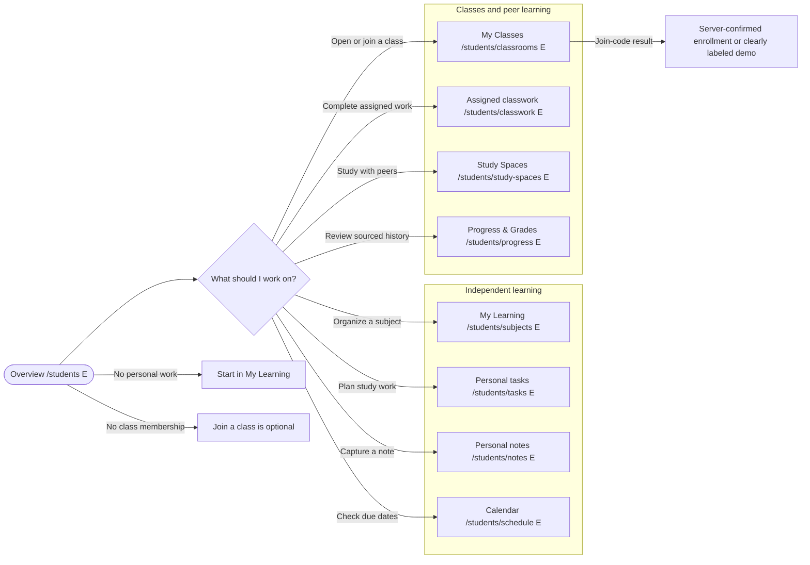

**Boundary:** Personal links work without a classroom. Upcoming classroom data, grades, or attendance must be omitted or marked unavailable if no authorized service supplies them.

### My Learning: `/students/subjects` (E entry), `/students/learning` (P hub)

**Sections:** `MyLearningView` (P) with personal subject list, continue-study panel, notes preview, tasks preview, and personal-resource shortcuts; `SubjectsView` (E) remains the focused subject list. A subject is student-owned and is not an official educator class.

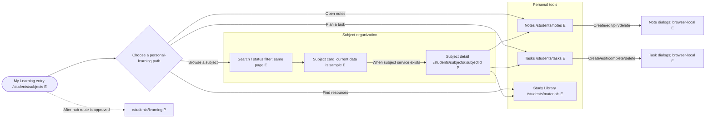

**Migration:** Update the sidebar from `/students/subjects` to `/students/learning` only when that hub has an `index.tsx` adapter and a real view. Keep `/students/subjects`, `/students/notes`, and `/students/tasks` reachable as focused/deep destinations; do not make a personal subject a classroom.

### My Classes: `/students/classrooms` (E)

**Sections:** `ClassroomsView` with enrolled-class cards and join-code form; `ClassroomDetailView` with feed, classwork, materials, people, schedule, attendance, and released-progress tabs; `ClassroomActivityView` for an activity. Tabs currently remain on the same class-detail URL.

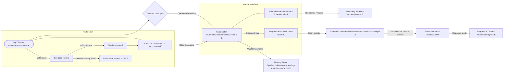

**Boundary:** The list/create/join classroom API exists, but detail tabs and activity submission/review are in-memory previews. Do not label a demo reply, grade, session, or submission as saved. Join links and invitations remain P until approved.

### Study Library: `/students/materials` (E)

**Sections:** `StudentLibraryView` (P) with source filter, search, resource list/cards, and a visible owner/context badge. Today's shared page only sends the user to the owning context.

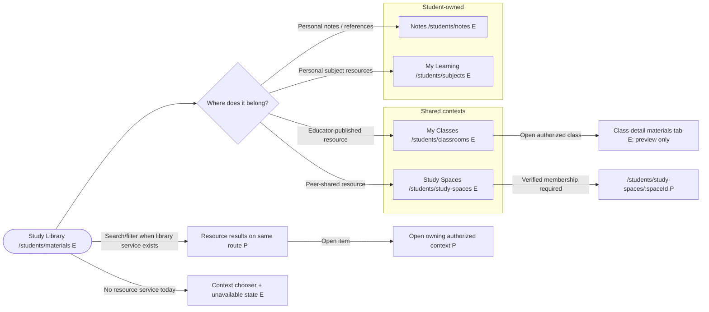

**Boundary:** A personal note, educator-published class file, peer-shared resource, and student submission have different owners. No upload/download, preview, or cross-context sharing should appear operational before the materials contract.

### Study Spaces: `/students/study-spaces` (E)

**Sections:** `StudySpacesView` with "Spaces you create" and "Spaces you join" rails, `CreateSpaceDialog`, and `JoinSpaceDialog`; future `StudySpaceDetailView` owns member list, shared resources/tasks, discussions, and space notices.

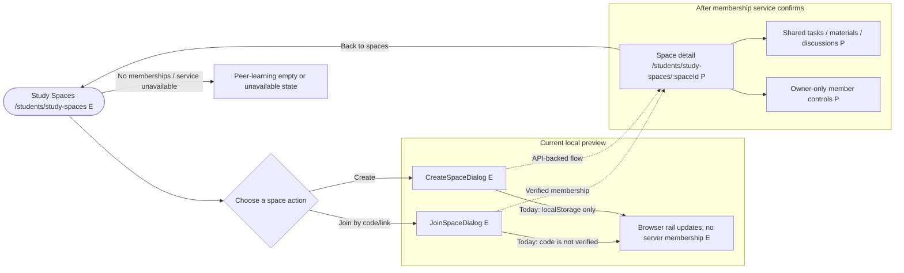

**Boundary:** Current "joined" records are local and do not prove membership. A peer space never creates official grades, educator feedback, or attendance; personal content is shared only through an explicit approved action.

### Meeting Room: `/students/classrooms/meeting-room` (E)

**Sections:** Full-screen `MeetingLobby`, `ParticipantGrid`, `RoomControls`, `MeetingChatPanel`, and `PeoplePanel`. The sidebar entry opens the separate lobby; an eligible classroom/session may link to the same route with a room code. The connected room is LiveKit-backed.

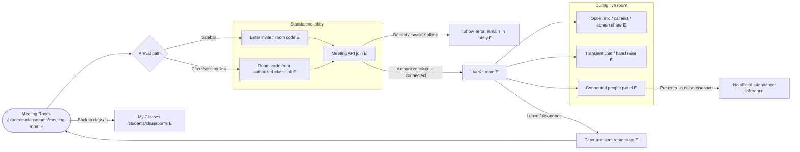

**Boundary:** The room is not a persistent messaging system or official roll call. A whiteboard, recording, meeting history, or student-host permission is not implied by the student route; the ESL whiteboard is a separately approved live-session feature.

### Discussions: `/students/communication` (E scaffold)

**Sections:** `DiscussionContextFilter`, classroom/peer thread list, thread detail with author/time/context, and an accessible reply composer (P). The current page previews discussions, announcements, and polls without saved posts.

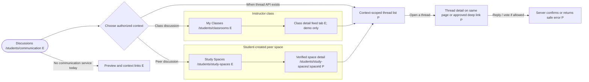

**Boundary:** Only authorized class/space members see content. A student cannot publish an educator announcement, alter official records, or treat in-room chat as a saved discussion. Direct Messages remain out of scope.

### Notifications: `/students/notifications` (E scaffold)

**Sections:** `NotificationFilters`, list grouped by source/date, item details, and source links (P). Current route has category cards and no delivered events or read state.

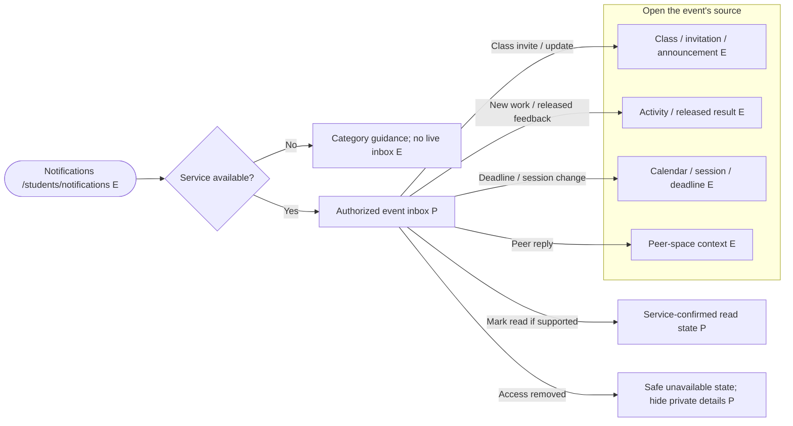

**Boundary:** Every event opens its owner context. Do not expose private grades/feedback to other members or claim delivery/read state from client-only changes.

### Calendar & Schedule: `/students/schedule` (E scaffold)

**Sections:** `CalendarGrid`, selected-day `DayAgenda`, source legend/filter, and event details. The current calendar only navigates dates; it does not save or load events.

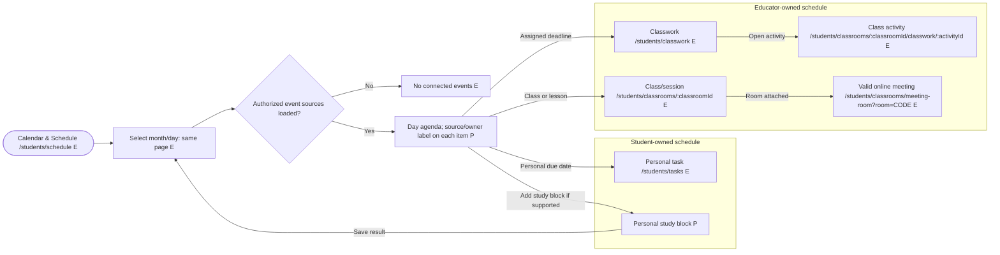

**Boundary:** A student may edit only their own events. Classroom sessions and educator deadlines stay read-only unless an approved contract says otherwise. Confirm timezone, recurrence, and reminder behavior before event CRUD.

### Tasks & Assessments: `/students/tasks` (E entry) and `/students/classwork` (E)

**Sections:** A target `TasksAndAssessmentsView` can provide distinct "Personal tasks" and "Assigned classwork" scope tabs/links. Existing `TasksView` owns personal task dialogs and browser-local persistence; `ClassworkView` displays sample assigned work and has no submission action.

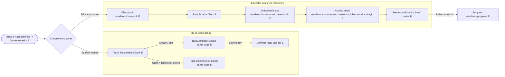

**Boundary:** Personal task completion is not an educator submission; a localStorage task is not account-synced. Keep the existing classwork link discoverable until a service-backed combined hub can show both scopes honestly.

### Progress & Grades: `/students/progress` (E scaffold)

**Sections:** Separate `PersonalProgressSection` for student-owned task/study history and `ClassroomResultsSection` for the student's released educator results, feedback, and permitted attendance. The current page explains the distinction but loads no records.

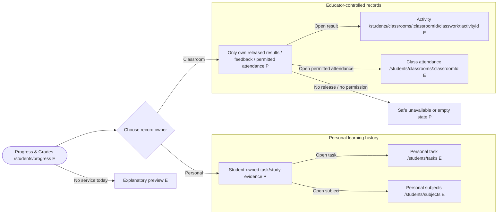

**Boundary:** No aggregate "grade" should be computed from personal tasks or peer collaboration. Official evaluation and attendance remain educator-controlled and are visible only to the authorized learner after release.

### AI Study Assistant: disabled sidebar item (D); `/students/ai-assistant` is an E preview

**Sections when approved:** `StudentAiView`, concise scope/safety guidance, prompt form, editable suggestion or practice output, and explicit optional actions for the student's own work. The current shared page describes educator AI and has no provider.

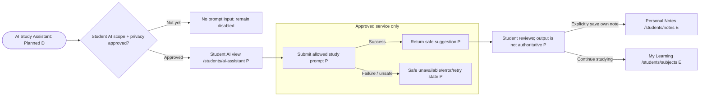

**Boundary:** No direct provider call from the browser, silent learner-data upload, classroom submission, published grade, or AI-generated official evaluation. Keep the sidebar disabled until a student-appropriate page and service exist.

### Help & Support: disabled sidebar item (D); `/students/help` (P)

**Sections when approved:** `StudentHelpView` with searchable help topics for personal workspace, class joining, peer spaces, submission guidance, meeting troubleshooting, and account recovery. A support-contact flow needs an approved delivery channel.

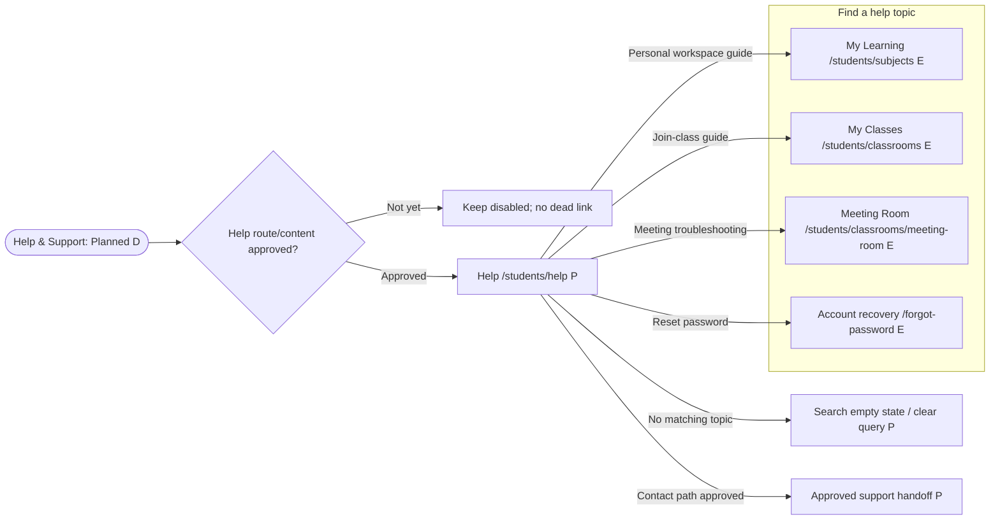

**Boundary:** An FAQ does not create a support ticket or send an email. Only show contact/send success after an approved service confirms it.

### Profile & Settings: disabled sidebar item (D); `/students/settings` (P)

**Sections when approved:** `StudentSettingsView` with server-backed account profile, privacy/preferences, and notification choices only if those fields are in the identity/profile contract. Sign-out already exists in the shared header.

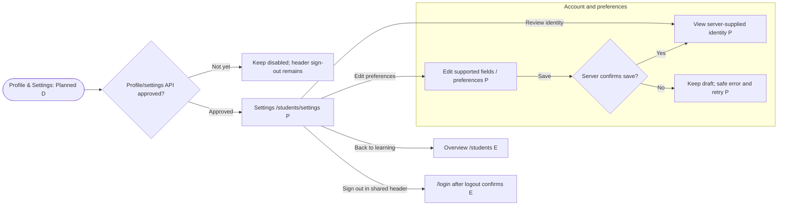

**Boundary:** Never expose authentication or email-link tokens in the DOM, localStorage, logs, or a screenshot. Route visibility and local form validation do not replace backend ownership/authorization.

### Universal page-state and navigation contract

- For every navigable page: define loading, first-use empty, filtered-empty, API unavailable, error/retry, permission denied, and authorized populated states where applicable. Use `Skeleton` only while loading, not as a permanent substitute for data.
- Any successful create/join/submit/save/mark-read action must be backed by the corresponding service response. Browser-only notes/tasks/study spaces must say they are browser-only; classroom detail demos must say they are demos.
- Preserve focus after dialogs and navigation, label every field, expose validation/status messages with appropriate semantics, and keep mobile and keyboard paths equivalent to pointer paths.
- A tab, filter, dialog, or in-room panel stays on its current URL unless this plan names a destination. Register proposed routes and update the sidebar/header source together; never render a clickable item that leads to a missing route.
- When access to a class, study space, resource, or notification is revoked, show a safe unavailable state and a route back to a valid list. Do not leak record titles, student identities, feedback, or grades in errors.

## Current implementation map and data boundaries

| Area | Current source | Current state |
|---|---|---|
| Student nav and shared nav data | `src/components/common/dashboard-navigation.ts`; renderer `src/components/common/app-sidebar.tsx` | The grouped student sidebar now shows the proposed labels. My Learning temporarily links to `/students/subjects`; Tasks & Assessments links to `/students/tasks`. Student AI, Help, and Settings are disabled Planned items. Header search includes route-backed items only; Meeting Room has the most-specific active item/title. |
| Routes and shared layout | `src/main.tsx`; `src/pages/dashboard/layout.tsx` | Role-prefixed nested routes remain unchanged; navigation is presentation context, not authorization. Student route adapters are thin; the shared classroom folder and dashboard layout still contain legacy non-index page files. |
| Student Overview | `src/pages/dashboard/students/index.tsx`; `src/components/features/personal-workspace/student-overview/` | Scaffold links and explanatory states; no student dashboard query. |
| Subjects | `src/pages/dashboard/students/subjects/`; `src/components/features/personal-workspace/subjects/` | Fixed sample dataset, read-only; no subject API. |
| Tasks and Notes | `src/components/features/personal-workspace/tasks/`; `.../notes/` | CRUD is localStorage/browser-only, initialized with sample data; not account-synced. |
| Study Spaces | `src/components/features/personal-workspace/study-spaces/` | localStorage/demo preview; membership and invite code are not server-verified. |
| Classrooms | `src/services/api/classroom.service.ts`; `src/components/features/classrooms/`; `src/pages/dashboard/classroom/` | List/create/join API endpoints exist; prototype provider blends API classroom headers with mock classroom records and in-memory detail state. Verify backend payloads/authorization before expanding. |
| Meeting Room | `src/services/api/meeting.service.ts`; `src/pages/dashboard/classroom/meeting-room.tsx` | Create/join/end API calls and LiveKit media/presence are connected. The sidebar links to this separate full page at a nested route. Chat/raised hands are transient packets, not persistent communication or attendance. Room route accepts a room query/invite or explicit room-code interaction. |
| Classwork/submissions | `src/components/features/classrooms/classroom-classwork-view.tsx`, `classroom-activity-view.tsx`; `src/components/features/personal-workspace/classwork/` | Mock or in-memory preview only; no classwork/submission service. |
| Schedule, materials, communication, notifications, progress, AI | `src/pages/dashboard/{schedule,materials,communication,notifications,progress,ai-assistant}/` | UI scaffolds/context previews; no event, material, discussion, notification, progress, or AI data service. |
| Profile/settings/help | Dashboard layout/auth session | Authenticated user name/role and sign-out exist; profile editing, support, and preferences do not have routes/services. |

Before implementation, re-check the route tree and service contracts because this snapshot may change. Preserve current user work and avoid reading `.env` files.

## Delivery roadmap

### Stage 0 — Product and API decisions

- Confirm the canonical account/role model and how student-only routes are authorized by the backend.
- Confirm study-space creator/member permissions and whether spaces are student-only.
- Define the student-facing classwork/submission status model, released-grade visibility, attendance visibility, and supported submission types.
- Define event timezone/recurrence/reminders; material storage/sharing; notification delivery/read state; and direct-message scope (still future by current decision).
- Decide whether/when student AI is in scope, what data it may use, and privacy/safety requirements.
- Define profile/settings and support-service contracts before adding controls.

### Stage 1 — Student independence first

- Establish Overview versus My Learning as distinct destinations and make independent learning the default no-class path.
- Add `students/learning/index.tsx` as a thin adapter to `personal-workspace/learning/my-learning-view.tsx` before changing the My Learning href; preserve focused Subjects, Notes, and Tasks routes and their deep links.
- Implement real personal subject CRUD, then wire personal notes and tasks to an approved account-scoped persistence service. Retire sample-only metrics as live-looking values.
- Keep current notes/task functionality clearly labeled browser-only until service persistence ships; handle empty, loading, validation, save failure, and offline/storage-unavailable states.
- Make personal resources discoverable in Study Library while keeping personal notes and files distinct.

### Stage 2 — Classroom participation

- Build My Classes around API-backed class list and join flows, with loading/empty/error/duplicate-code states.
- If the shared classroom adapters are migrated to the index-only convention, move detail, activity, and Meeting Room adapters into their own `index.tsx` route folders without changing existing URLs or LiveKit behavior.
- Replace demo detail data with authorized class/lesson, materials, classwork, session, discussion, attendance, and released-result APIs as contracts become available.
- Keep Meeting Room as a standalone page reachable from the sidebar, and allow class/session actions to deep-link into that page with a valid room selected. Reuse the existing meeting service and LiveKit room; do not use meeting chat or room presence as persistent class communication/attendance.

### Stage 3 — Academic organizer

- Connect Calendar & Schedule to personal events, class sessions, and classwork deadlines with clear context and time-zone rules.
- Present personal tasks and assigned assessments under a common student destination while maintaining separate data models and permissions.
- Connect personal progress and released official grades/feedback/attendance as separate sections, with accessible text summaries and real records only.

### Stage 4 — Peer collaboration and contextual communication

- Add server-backed Study Spaces with confirmed membership, invitation, ownership, and sharing behavior.
- Add contextual discussions/announcements/polls and notifications only with APIs that confirm save/delivery/read states and classroom isolation.
- Keep direct Messages off the active sidebar until its own requirements and services are approved.

### Stage 5 — Student tools and account completion

- Design and implement a student-specific AI assistant only after product, provider, privacy, and safety decisions.
- Add Profile & Settings and Help & Support when authenticated profile/preferences and support workflows are defined.
- Add any additional cross-cutting search or recommendations only after their data scope, privacy, and service behavior are agreed.

## Acceptance criteria for the proposal and later implementation

- A student can understand and start the independent workflow without joining a class; Overview is not a duplicate of My Learning.
- My Classes, My Learning, Study Spaces, and Study Library each communicate their purpose and data owner.
- Personal notes/tasks/progress, peer-space content, and educator-controlled classwork/grades/attendance are visibly and technically separate.
- Sidebar items lead to real student-prefixed routes; active state, page title, search result labels, mobile behavior, and keyboard/focus behavior remain coherent.
- Meeting Room is reachable as a standalone sidebar page, with optional deep links from relevant classes/sessions; meeting presence/chat is not described as saved communication or official attendance.
- Direct Messages are clearly future, not represented by the current contextual communication preview.
- Every student route folder added or refactored contains only `index.tsx`; it is a thin adapter to a feature view. Feature sections, local state, forms, schemas, and data access are outside `src/pages/`.
- Every page flowchart routes to a registered path or labels the target `P`/disabled; dialog, tab, filter, and panel actions are explicitly same-page interactions rather than fake routes.
- Each page's component inventory maps to wrappers that actually exist under `src/components/ui/`; no Radix-only `asChild` API or nonexistent Popover wrapper is assumed.
- Every unfinished feature is labeled accurately; sample/demo data, localStorage data, and server-confirmed data are not conflated.
- Pages define useful loading, empty, error/unavailable, and permission states; sensitive record visibility remains backend-authorized.
- No new dependencies or invented endpoints/permissions are introduced without explicit approval.

## Likely application files if implementation is separately approved

- Navigation/search/title mapping: `src/components/common/dashboard-navigation.ts`, `src/components/common/app-sidebar.tsx`, `src/pages/dashboard/layout.tsx`.
- Route registration: `src/main.tsx`; student adapters in `src/pages/dashboard/students/**/index.tsx`; proposed My Learning, Subject Detail, Study Space Detail, Help, and Settings route folders are listed in the implementation blueprint above.
- Student feature modules: `src/components/features/personal-workspace/student-overview/`, `learning/` (P), `subjects/`, `tasks/`, `notes/`, `study-spaces/`, and `classwork/`.
- Shared student-visible feature views: `src/components/features/classrooms/`, `meeting-room/` (P extraction), `materials/`, `schedule/`, `communication/`, `notifications/`, `progress/`, `student-ai/`, `student-help/`, and `student-settings/`.
- Existing shared route adapters: `src/pages/dashboard/classroom/`, `schedule/`, `materials/`, `communication/`, `notifications/`, `progress/`, and `ai-assistant/`. Their substantive JSX should be extracted when those features are implemented; do not edit them as part of this plan.
- New API modules/types only after backend contracts are confirmed: `src/services/api/`.
- No source edits, dependency changes, API calls, or configuration changes are part of this proposal/roadmap plan.
