# Owlio Tutor Sidebar and Workflow Megaplan

Recommend a tutor-first information architecture and end-to-end workflow for one-to-one and group tutoring, including page responsibilities, ownership boundaries, current route/API status, and a backend-aware delivery roadmap.

This is the detailed Tutor workspace specification linked from the [Owlio Product Plan](OWLIO_PRODUCT_PLAN.md#4-four-role-workspaces-and-their-connected-learning-contexts). Use the product plan for shared capabilities, cross-role ownership boundaries, and delivery dependencies; use this document for tutor navigation, page requirements, click flows, and acceptance criteria. Current source, runtime flags, and confirmed backend contracts determine implementation status; the current-state snapshots below must be rechecked before implementation.

## Objective and confirmed decisions

- Deliver a product/UX proposal, current frontend/service map, and sequenced implementation roadmap for the tutor workspace.
- Focus on private, online, and independent tutoring—not school-only teacher workflows and not ESL-specific language instruction. Keep the shared tutoring model usable across subjects such as math, programming, writing, and academic review.
- Support one-to-one and group tutoring. Plan online Meeting Room sessions plus in-person/hybrid session metadata where supported by the eventual session contract; do not require every session to use Owlio video.
- Use contextual Discussions rather than promising a direct-message inbox. Direct one-to-one/group messages remain future until product, delivery, privacy, and backend contracts exist.
- Separate tutor-only Session Notes from learner-visible, explicitly published feedback.
- Split **Materials** from **Student Progress/Insights**. Put evidence-based insight summaries with the relevant learner progress; do not mix file management with analytics.
- Do not assume a school, class roster, school gradebook, grading scale, institutional term, tutor payments, or advanced tutoring-business scheduling.
- Treat all product capabilities as planned until source and confirmed API contracts demonstrate that they are implemented. No endpoints, roles, data persistence, or permissions are to be invented.

## Recommended tutor sidebar

```text
Overview

LEARNER MANAGEMENT
- My Learners
- Learning Plans
- Activities & Evaluations

SESSIONS & COMMUNICATION
- Sessions & Schedule
- Session Attendance
- Session Notes
- Meeting Room
- Discussions
- Announcements
- Notifications

RESOURCES & PROGRESS
- Teaching Materials
- Student Progress
- AI Tutor Assistant

ACCOUNT
- Profile & Settings
```

### Recommended additions and changes

- Rename **My Students** to **My Learners**. Tutors may teach adults, individuals, or groups outside a school; “learner” avoids implying formal enrollment or a school roster. Retain “students” in product copy if that is the chosen brand vocabulary.
- Keep **Learning Plans** for goals across multiple sessions, not as a duplicate lesson/agenda editor. Put the agenda for one meeting inside its session detail.
- Rename **Assignments** to **Activities & Evaluations**. This supports practice, homework, projects, review, and tutor evaluation without implying a school-only assignment or grading system. The page can still label learner-facing work “Assignments” where appropriate.
- Add **Session Attendance**. It is an important tutor-controlled session record and should not be inferred from LiveKit presence or meeting duration.
- Move **Session Notes** beside Sessions & Communication because notes belong to a session and its learner context. Keep private notes separate from feedback intentionally published to learners.
- Keep **Meeting Room** as a standalone destination, but link to it from eligible online sessions. Do not present every scheduled tutoring appointment as an online meeting.
- Replace **Messages** with **Discussions** for contextual threads attached to a learner, group, session, or activity. Keep in-call chat transient and separate from saved discussions. Direct messages remain future.
- Add **Announcements** and **Notifications**. Announcements are tutor-authored updates to an intended learning group; notifications are service-confirmed events and links back to their source.
- Rename **Materials & Insights** to **Teaching Materials**. Keep progress and evidence-based learner insights under **Student Progress**; avoid a combined file-library/analytics destination.
- Keep **AI Tutor Assistant** clearly tutor-facing. It can help the tutor prepare plans, practice activities, and feedback drafts; do not imply an autonomous student-facing AI tutor or final evaluator.
- Do not add a separate payments, invoicing, or business-scheduling page in this plan. Product direction lists those as future enhancements; the current objective is the teaching/learning workflow.

## End-to-end tutor workflow

1. Open Overview to see upcoming sessions and any learner/activity follow-up that is backed by real data.
2. Add or open an individual learner or tutoring group; establish the tutoring relationship and permitted learner profile.
3. Set or review a multi-session Learning Plan with tutor-authored objectives, milestones, and next steps.
4. Prepare a specific session with an agenda/lesson focus, relevant Teaching Materials, and an Activity or Evaluation.
5. Schedule the session as online, in-person, or hybrid only as the service supports; attach a Meeting Room only for an online session that has a valid room.
6. Teach: join the Meeting Room if online, or use the session details for in-person/hybrid instruction. Meeting chat and presence remain live-only interactions.
7. Record Session Attendance through an explicit educator workflow, independent of whether a learner joined the video room.
8. Review learner work, provide a tutor evaluation, publish learner-visible feedback intentionally, and keep private Session Notes private.
9. Review Student Progress using sourced activities, sessions, attendance, and published evaluations without representing tutoring evaluations as institutional grades.
10. Use AI Tutor Assistant suggestions as editable drafts; the tutor remains responsible for all teaching decisions, evaluations, and learner communication.

## Page responsibilities and content

### Overview

**Purpose:** Give the tutor a practical daily starting point without displaying fabricated counts or requiring a school/classroom model.

- Upcoming one-to-one and group sessions with date/time, learner/group, subject/topic, delivery mode, and a Meeting Room action only where a valid online room is attached.
- A focused action queue for session preparation, activities to review, attendance to record, feedback drafts, and follow-up items, only when these are backed by real records.
- Quick actions to add a learner/group, create a Learning Plan, schedule a session, prepare an activity, or add a teaching resource.
- Learner progress highlights only when sourced from actual, authorized records and with a link to the learner context.
- First-use empty state: add a learner, establish a learning goal, or create a first session; include non-school language and an optional in-person/hybrid path.
- Existing route: `/tutors`. Current dashboard has “--” stats and honest empty session/AI states; no tutor dashboard query exists.

### My Learners

**Purpose:** Organize individuals and groups the tutor is authorized to teach.

- Search/filter individuals and groups, with membership/relationship status only when supported.
- Profile details appropriate to tutoring: preferred name, contact/learning context, tutor-defined goals, and relevant learner preferences. Sensitive/private fields require explicit access rules.
- A learner detail view links to that learner’s plans, scheduled sessions, activities, attendance, private notes, released feedback, materials, and progress.
- Group view shows the group’s shared learning context while preserving learner-specific submissions, notes, feedback, and attendance as individual records.
- Do not require school enrollment, grade, section, or institutional role; do not expose another tutor’s learners or records.
- Existing route: `/tutors/learners` presents sample group tabs and empty learner/submission/progress states. No learner or tutoring-group API exists.

### Learning Plans

**Purpose:** Track a learner’s or group’s longer-term tutoring goals across multiple sessions.

- Tutor-authored goals, focus topics/skills, target outcomes, milestones, and next steps, associated with one learner or an explicitly supported group.
- Link a plan to related sessions, activities, materials, and feedback; show the source/context of each activity.
- Keep a learning plan distinct from the agenda for one session and from an official school curriculum/gradebook.
- Allow progress updates only through confirmed workflows; no AI-generated or inferred mastery/level should silently change a plan.
- No Learning Plans route/service currently exists. A new role-prefixed destination (candidate: `/tutors/learning-plans`) requires a product/data contract.

### Activities & Evaluations

**Purpose:** Prepare practice and assignments, collect learner work, and record tutor-controlled evaluations and feedback.

- Cross-learner/group activity list with filters for learner/group, subject/topic, session, due date, activity type, and review state where the API supports them.
- Support flexible tutoring work: exercises, quizzes/practice, reading or project work, written/file/link submissions, demonstrations, and other contract-defined activity types.
- Activity detail contains instructions, related plan/session/materials, learner-specific responses, and any approved evaluation criteria.
- Provide a submission/review queue; tutor evaluations and feedback are controlled by the tutor. Distinguish a private observation from feedback released to the learner.
- Use the API’s status lifecycle. Do not assume that school-oriented points, grades, auto-grading, late rules, or revision windows apply to tutoring.
- Existing route: `/tutors/classwork` is explanatory copy only. Shared classroom activity forms are in-memory demo state; there is no tutor activity/submission service.

### Sessions & Schedule

**Purpose:** Manage actual tutoring appointments separately from longer-term Learning Plans.

- Session list/calendar with individual/group participant context, date/time/timezone, topic/lesson focus, duration only if the product defines it, and delivery mode: online, in-person, or hybrid only where supported.
- Session detail includes agenda, related plan, materials, activities, attendance, private notes, learner-visible feedback, and an online meeting link only where valid.
- Support recurring sessions or rescheduling only after timezone, recurrence, cancellation, and conflict rules are agreed with the product/backend.
- A scheduled session can link to the Meeting Room, but not every session should be represented as an online room.
- Existing `/tutors/sessions` is an empty UI scaffold; `/tutors/schedule` reuses a generic monthly calendar with no event data or persistence.

### Session Attendance

**Purpose:** Record tutor-controlled attendance for an individual or group session.

- Select the actual session and show its date/time and eligible learner/group roster.
- Provide only approved states and operations (for example, present/absent/late/excused if that status model is confirmed); keep individual attendance distinct within a group.
- Provide history by learner and session, with correction/audit behavior from the backend contract.
- LiveKit roster, room duration, chat, screen-share, or connectivity must not silently create official attendance. In-person/hybrid sessions need a manual or otherwise approved attendance flow.
- Existing `/tutors/attendance` is an explanatory empty state with no attendance service.

### Session Notes

**Purpose:** Capture private tutor observations tied to a specific learner/group and session.

- Private notes should have an explicit tutor-only audience, session/learner context, author, and date.
- Do not put these notes in learner-visible activity feeds, notifications, progress exports, or feedback records.
- A separate “Publish feedback” action should create or update a learner-visible feedback record only after the tutor confirms the audience and content.
- Define retention, edit/delete, access/audit, and group-session privacy rules before storing notes that may contain sensitive learner information.
- No dedicated Session Notes route or service exists. The classroom prototype’s progress/feedback data is in-memory and is not a private notes store.

### Meeting Room

**Purpose:** Provide a standalone live video/meeting page for online tutoring sessions.

- Retain a lobby/invite-code entry, active session view, opt-in microphone/camera, screen sharing, participant panel, in-call chat, hand raise, recoverable connection errors, and clean leave/end state.
- From Sessions & Schedule, link to the Meeting Room with the session’s actual meeting identifier when one exists. The standalone page remains separately reachable as requested by this product pattern.
- Restrict room creation/end to server-authorized tutor/host roles. A `/tutors` route prefix is presentation context, not permission.
- In-room chat and hand raises are transient to the active LiveKit room; they are not saved Discussions, session notes, attendance, or learner progress.
- Existing route: `/tutors/classrooms/meeting-room` uses the shared meeting-room page. The meeting service supports create/join/end and LiveKit supplies connected media/presence.

### Discussions (replaces Messages)

**Purpose:** Keep tutoring conversations attached to their subject and learning context.

- Threads may be scoped to a learner, group, session, or activity with clear author, time, audience, and reply context.
- Respect whether the context is private one-to-one or visible to a group; do not allow a private tutor note to become a discussion post.
- Direct one-to-one or group inbox messaging is not part of the first scope. Meeting Room chat remains transient and separate.
- Existing `/tutors/communication` is a shared UI preview for discussions/announcements/polls; posts and replies are not saved or delivered.

### Announcements

- Tutor-authored updates for a defined learning group/learner context, such as a session change or preparation instructions.
- Show intended audience and publication state. Scheduling, editing, deletion, and delivery confirmations depend on service support.
- Announcements are not private notes, direct messages, or notification delivery records. No announcement service currently exists.

### Notifications

- Link confirmed events to their source: invitation/membership, upcoming session, new activity, a submission, published feedback, or a discussion/announcement.
- Read/unread state, channels, reminders, and delivery claims require an API contract. Protect private notes and learner evaluation content from unauthorized previews.
- Existing `/tutors/notifications` has an empty-state preview only; notification delivery/read state is not connected.

### Teaching Materials

**Purpose:** Provide one tutor-facing resource library that can be reused across authorized learners, groups, subjects, and sessions.

- Organize tutor-owned materials by learner/group, topic/subject, learning plan, session, and resource type as supported.
- Show owner, intended audience, and current use; explicitly share a tutor-private resource before making it learner-visible.
- Support only file/link types, previews, uploads, and sharing rules defined by the backend. Do not promise external-drive integration or upload limits without a contract.
- Existing `/tutors/materials` is a shared context-selection page; there is no resource upload/browse service.

### Student Progress

**Purpose:** Show evidence-based tutoring progress for the selected learner/group without implying institutional grades.

- Summarize completed sessions, attendance, activities, tutor evaluations, published feedback, and learning-plan milestones using actual authorized records.
- Keep learner-level and group-level progress distinguishable. Group summaries must not expose a learner’s private notes or evaluation to other members.
- Label the source, date, and tutor-defined criteria. Avoid automatic mastery/grade labels or progress trends from missing/sample data.
- Include report/export only after access scope, format, and privacy contracts are approved.
- Existing `/tutors/progress` reuses a generic empty progress page; the tutor Learners page uses placeholders; no progress/report service exists. Progress insights live here rather than inside the Materials page.

### AI Tutor Assistant

**Purpose:** Assist the tutor in preparation and review; it is not an autonomous AI tutor for learners.

- Potential tutor-facing tasks: draft lesson/activity ideas, generate practice questions, adapt an explanation, organize a plan around tutor-selected goals, or draft feedback.
- Require tutor-supplied context and keep generated output clearly marked as a draft. The tutor edits and approves before using it with a learner.
- Do not autonomously contact learners, create/publish assignments, decide learner mastery, issue final evaluation, or alter progress/attendance records.
- Do not send sensitive learner/session notes to an AI provider until provider, privacy, retention, and backend service contracts are approved. Do not call an AI provider directly from the browser.
- Existing `/tutors/ai-assistant` reuses an educator-facing explanatory page; no generation provider/service is present.

### Profile & Settings

- Potential account/profile information and preferences should use the authenticated profile/settings contract; keep sign-out available.
- Define tutor-specific profile fields/preferences and notification settings before making forms editable. Do not treat onboarding subtype or `/tutors` URL context as persistent authorization.
- The dashboard currently displays the authenticated user and supports sign-out, but has no profile/settings route or profile-update service.

## Current route, API, and data-flow map

| Area | Current source | Verified implementation status |
|---|---|---|
| Tutor navigation | `src/components/common/dashboard-navigation.ts`; `src/components/common/app-sidebar.tsx` | Tutor sidebar now has the grouped labels in this plan. Existing routes are linked; Learning Plans, Session Notes, Announcements, and Profile & Settings remain disabled/planned until routes exist. Header search includes route-backed entries only. |
| Routes/layout | `src/main.tsx`; `src/pages/dashboard/layout.tsx` | Tutor routes are role-prefixed under `/tutors`; role-prefixed route guard requires authentication only. Frontend URL context is not authorization. |
| Overview | `src/pages/dashboard/tutors/index.tsx` | “--” statistics and empty upcoming-session/AI states; no tutor overview query. |
| My Learners | `src/pages/dashboard/tutors/learners/index.tsx` | Group tabs and learner/progress/submission areas are placeholder UI. No learner or group service; no real learner data is loaded. |
| Learning Plans | No current tutor route/page | Product concept needs a new role-prefixed page/component and an approved learner-plan data contract. |
| Assignments/activities | `src/pages/dashboard/tutors/classwork/index.tsx`; `src/components/features/classrooms/classroom-classwork-view.tsx`; `classroom-activity-view.tsx` | Tutor page is explanatory scaffolding. Shared classroom activity authoring/submission/review is mock/in-memory state. No tutor activity/submission API. |
| Sessions/schedule | `src/pages/dashboard/tutors/sessions/index.tsx`; `src/pages/dashboard/schedule/index.tsx` | Tutor sessions are a scaffold; generic schedule shows a month grid but loads/saves no events. No scheduling service. |
| Attendance | `src/pages/dashboard/tutors/attendance/index.tsx` | Empty explanatory view; no attendance service. |
| Session Notes | No dedicated tutor route/component/service | Must not reuse mock classroom progress as persistent private notes. |
| Meeting Room | `src/pages/dashboard/classroom/meeting-room.tsx`; `src/services/api/meeting.service.ts` | Shared full-screen page with meeting API create/join/end and LiveKit media/presence. In-call chat/hand state is transient, not saved tutoring communication or official attendance. |
| Materials | `src/pages/dashboard/materials/index.tsx` | Context cards for tutoring resources, but no browse/upload/share service. |
| Communication/notifications | `src/pages/dashboard/communication/index.tsx`; `src/pages/dashboard/notifications/index.tsx` | Preview-only conversation categories and empty notification state; no persisted posts, direct messages, delivery, or read-state service. |
| Progress/AI | `src/pages/dashboard/progress/index.tsx`; `src/pages/dashboard/ai-assistant/index.tsx` | Shared explanatory/empty-state pages; no tutor progress query or AI integration. |
| Classroom API/prototype | `src/services/api/classroom.service.ts`; `src/components/features/classrooms/classroom-prototype-provider.tsx`; `classroom-mock-data.ts` | Classroom list/create/join calls exist. Provider also seeds sample tutor class/session data and holds classroom details/actions in memory. Do not present the sample “Math Study Group” or mock attendance/work as live tutoring data. |
| API inventory | `src/services/api/` | Services exist for authentication, health, classroom list/create/join, and meeting create/join/end. No tutor learner, group, plan, session/schedule, assignment, attendance, notes, materials, communication, notification, progress, AI, billing, or settings service exists. |

The registration/onboarding role contract is still inconsistent: authentication uses account types `student` and `educator`, while onboarding has additional educator/tutor-like subtypes that are not persisted by authentication. Confirm the canonical tutor identity/profile/authorization contract before treating `/tutors` or a client-selected subtype as an access boundary.

## Route and component implementation blueprint

This is the target frontend architecture, not a statement that all listed pages/services exist. `E` means an existing route, `P` means a proposed route, and `D` means a sidebar item that remains disabled/planned until its route and service are approved.

### Route inventory

| Sidebar destination | Route | Status and intended route behavior |
|---|---|---|
| Overview | `/tutors` | E. Tutor dashboard scaffold. |
| My Learners | `/tutors/learners` | E. Current placeholder directory/group view. |
| Learning Plans | `/tutors/learning-plans` | P. Multi-session goal/plan workspace, distinct from one-session agenda. |
| Activities & Evaluations | `/tutors/classwork` | E. Current explanatory activity/evaluation page. |
| Sessions & Schedule | `/tutors/sessions` | E. Current session-planning scaffold; target becomes the tutoring-session hub/calendar entry. Keep `/tutors/schedule` as a role-prefixed calendar deep link where useful. |
| Session Attendance | `/tutors/attendance` | E. Empty attendance/history preview, no record service. |
| Session Notes | `/tutors/session-notes` | P. Tutor-only notes; separate from feedback published to learners. |
| Meeting Room | `/tutors/classrooms/meeting-room` | E. Standalone shared LiveKit page; online sessions deep-link here only with a valid room. |
| Discussions | `/tutors/communication` | E. Shared contextual communication preview; no direct inbox. |
| Announcements | `/tutors/announcements` | P. Tutor-authored notice page for an explicit learner/group audience. |
| Notifications | `/tutors/notifications` | E. Empty-state preview; no delivery/read service. |
| Teaching Materials | `/tutors/materials` | E. Context chooser, not a connected material library. |
| Student Progress | `/tutors/progress` | E. Generic no-data progress preview; target tutor-specific, sourced evidence. |
| AI Tutor Assistant | `/tutors/ai-assistant` | E. Shared educator-preparation scaffold; no AI provider/generation. |
| Profile & Settings | `/tutors/settings` | P. Requires authenticated profile/preferences API. |

Supporting existing class routes remain `/tutors/classrooms`, `/tutors/classrooms/:classroomId`, and `/tutors/classrooms/:classroomId/classwork/:activityId`. They are reached contextually from learner/session/activity views; the proposed sidebar does not add a separate My Classes item.

### `index.tsx`-only route adapters

- Every new or refactored route directory under `src/pages/` should contain only `index.tsx`. Each adapter imports one feature view and returns it; do not put screen sections, form state, mock arrays, API requests, or business rules in route adapters.
- Register routes in `src/main.tsx`; keep tutor URLs role-prefixed under `/tutors`. A role-prefixed route is navigation context, not authentication or authorization.
- Existing tutor route folders `index`, `sessions`, `classwork`, `attendance`, and `learners` already have `index.tsx` adapters.
- Proposed route folders: `learning-plans/index.tsx`, `learners/detail/index.tsx`, `session-notes/index.tsx`, `announcements/index.tsx`, and `settings/index.tsx`; add each route only after its page and product/API contract are approved.
- Shared classroom exceptions are `src/pages/dashboard/classroom/detail.tsx`, `activity.tsx`, `meeting-room.tsx`, and `meeting-room.lazy.tsx`. A separately approved shared-route cleanup can move these to `classroom/detail/index.tsx`, `classroom/activity/index.tsx`, and `classroom/meeting-room/index.tsx` while preserving current URLs and lazy loading.
- `src/pages/dashboard/layout.tsx` is a shared layout route rather than a tutor screen; moving it under `src/components/layouts/` is a cross-app cleanup, not a tutor feature requirement. Root `src/pages/App.tsx` is also outside this tutoring scope.
- Shared classroom, schedule, materials, communication, notifications, progress, and AI screens should delegate to role-aware feature views. Keep tutoring labels flexible and do not duplicate the shared classroom implementation.
- Use the local Base UI-based wrappers as used by neighboring code. Use `Button render={<Link to="..." />}` for Router links; do not assume Radix `asChild`. Local `Tabs` use `value` and `onValueChange`.

### File placement and component ownership

The tree shows target locations, not files to create in this documentation change. `(E)` means existing; `(P)` means proposed.

```text
src/pages/dashboard/tutors/
  index.tsx                            # E: route adapter -> TutorOverviewView
  learners/index.tsx                   # E: route adapter -> TutorLearnersView
  learners/detail/index.tsx            # P: route adapter -> TutorLearnerDetailView
  sessions/index.tsx                   # E: route adapter -> TutorSessionsView
  classwork/index.tsx                  # E: route adapter -> TutorActivitiesView
  attendance/index.tsx                 # E: route adapter -> TutorAttendanceView
  learning-plans/index.tsx             # P: route adapter -> LearningPlansView
  session-notes/index.tsx              # P: route adapter -> TutorSessionNotesView
  announcements/index.tsx              # P: route adapter -> TutorAnnouncementsView
  settings/index.tsx                   # P: route adapter -> TutorSettingsView

src/pages/dashboard/classroom/
  index.tsx                            # E: shared class list adapter
  detail/index.tsx                     # P migration of current detail.tsx adapter
  activity/index.tsx                   # P migration of current activity.tsx adapter
  meeting-room/index.tsx               # P migration/lazy adapter for current meeting-room view

src/components/features/
  tutor-workspace/
    overview/tutor-overview-view.tsx           # P: daily dashboard composition
    overview/upcoming-sessions.tsx              # P
    overview/follow-up-queue.tsx                # P
    learners/tutor-learners-view.tsx             # P: refactor existing placeholder
    learners/learner-directory.tsx               # P
    learners/learner-detail-view.tsx              # P
    learning-plans/learning-plans-view.tsx        # P
    learning-plans/plan-editor.tsx                # P
    activities/tutor-activities-view.tsx           # P
    activities/activity-builder/                  # P: form sections/schemas
    activities/submission-review-queue.tsx         # P
    sessions/tutor-sessions-view.tsx               # P: refactor existing placeholder
    sessions/session-calendar.tsx                  # P
    sessions/session-detail-view.tsx               # P
    attendance/tutor-attendance-view.tsx             # P
    attendance/session-picker.tsx                   # P
    attendance/attendance-roster.tsx                # P
    notes/tutor-session-notes-view.tsx               # P
    notes/private-note-editor.tsx                    # P
    notes/published-feedback-view.tsx                # P: distinct learner-visible records
    materials/tutor-materials-view.tsx                # P: refactor shared materials context
    progress/tutor-student-progress-view.tsx          # P
    communication/discussions-view.tsx                # P
    communication/announcements-view.tsx              # P
    notifications/tutor-notifications-view.tsx        # P
    ai/tutor-ai-assistant-view.tsx                     # P
    settings/tutor-settings-view.tsx                   # P
  classrooms/                                      # E: shared class detail/feed/records/activity views
  meeting-room/                                    # E/P: extract shared LiveKit screen
  schedule/                                        # P: shared calendar sections
  ui/                                              # E: domain-neutral wrappers
src/components/layouts/
  platform-layout.tsx                             # P: move shared dashboard layout in separate cleanup
```

### Checked-in shadcn-style component mapping

Reuse wrappers from `src/components/ui/`; they are project-owned Base UI wrappers, not raw Radix components. This is a page-by-page toolkit suggestion, not a requirement to use every primitive.

| Tutor page | Suitable checked-in wrappers |
|---|---|
| Overview | `Card`, `Badge`, `Button`, `Empty`, `Skeleton`, `Alert`; `Progress` only for sourced metrics. |
| My Learners | `Input`, `Select`, `Tabs`, `Card`, `Avatar`, `Badge`, `Table`, `Empty`, `Skeleton`, `Alert`. |
| Learning Plans | `Tabs`, `Card`, `Field`, `Input`, `Textarea`, `Select`, `Button`, `Badge`, `Dialog`, `Empty`, `Skeleton`. |
| Activities & Evaluations | `Tabs`, `Card`, `Table`, `Field`, `Input`, `Textarea`, `Select`, `Checkbox`, `Dialog`, `Badge`, `Alert`, `Empty`, `Skeleton`. |
| Sessions & Schedule | `Card`, `Tabs`, `Button`, `Select`, `Table`, `Badge`, `Dialog` or `Drawer`, `Empty`, `Skeleton`, `Alert`. |
| Session Attendance | `Select`, `Table`, `Checkbox`, `Card`, `Badge`, `Alert`, `Empty`, `Skeleton`, `Collapsible`, `Button`. |
| Session Notes | `Tabs`, `Card`, `Field`, `Textarea`, `Input`, `Badge`, `Button`, `Dialog`, `Alert`, `Empty`; make note audience visible. |
| Meeting Room | Existing custom LiveKit controls plus `Button`, `Drawer`, `ScrollArea`, `Alert`, `Badge`; media remains opt-in. |
| Discussions | `Tabs`, `Card`, `Badge`, `Textarea`, `Field`, `Button`, `ScrollArea`, `Empty`, `Alert`. |
| Announcements | `Card`, `Field`, `Input`, `Textarea`, `Select`, `Button`, `Badge`, `Dialog`, `Alert`, `Empty`. |
| Notifications | `Card`, `Tabs`, `Badge`, `Button`, `Empty`, `Skeleton`, `Alert`. |
| Teaching Materials | `Card`, `Tabs`, `Input`, `Select`, `Badge`, `Attachment`, `Empty`, `Skeleton`, `Alert`; do not expose upload actions without storage support. |
| Student Progress | `Card`, `Tabs`, `Table`, `Progress`, `Badge`, `Empty`, `Skeleton`, `Alert`; provide text equivalents and sources for charts. |
| AI Tutor Assistant | `Card`, `Field`, `Textarea`, `Input`, `Select`, `Button`, `Alert`, `Badge`, `Skeleton`, `Dialog` for review. |
| Profile & Settings | `Card`, `Field`, `Input`, `Switch`, `Button`, `Alert`; editable only for API-supported fields. |

Complex forms may use React Hook Form/Zod where consistent with existing code; schemas belong beside their feature. No new UI dependency is required by this plan.

## Tutor page click-through flowcharts

Each chart begins at its sidebar destination. `E` means an existing route, `P` a proposed route/action, and `D` a disabled/planned item. Mermaid subgraphs visually group related paths; open this Markdown in a Mermaid-enabled preview to see rendered diagrams instead of source. Same-page tabs, dialogs, and filters are labeled as such.

### Overview: `/tutors` (E)

**Sections:** tutor welcome, upcoming session agenda, activity review queue, learner follow-ups, and sourced metrics.

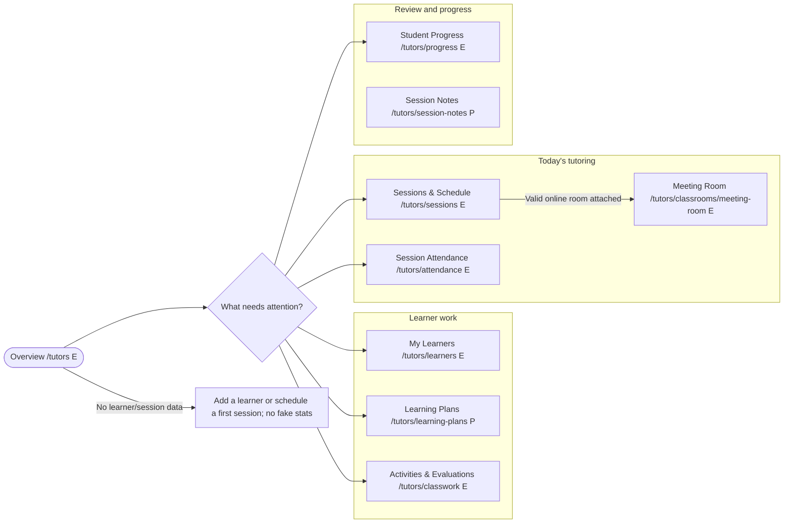

### My Learners: `/tutors/learners` (E)

**Sections:** individual/group selector, learner search, authorized profile context, active Learning Plans, upcoming sessions, activity history, and clear private/published record labels.

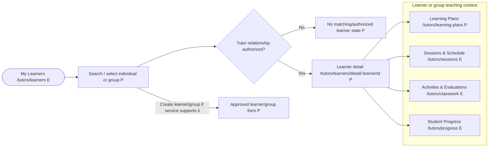

### Learning Plans: `/tutors/learning-plans` (P)

**Sections:** learner/group selector, tutor-authored goals, focus areas, milestones, linked session history, and next steps.

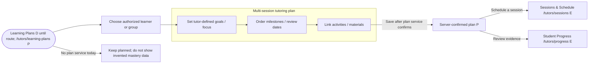

### Activities & Evaluations: `/tutors/classwork` (E)

**Sections:** learner/group and session context, practice/activity list, submission review, tutor evaluation, and a distinct publish-feedback action.

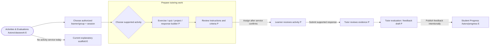

**Boundary:** Do not assume school grading scales, supported response types, scoring, or lifecycle labels for tutoring. Tutor evaluations are not institutional grades.

### Sessions & Schedule: `/tutors/sessions` (E)

**Sections:** individual/group session agenda, delivery mode, time/timezone, topic, agenda, linked Learning Plan/material/activity, and Meeting Room action only when an online room exists.

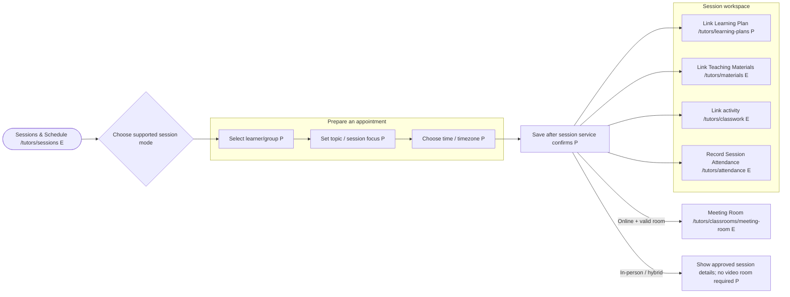

**Boundary:** Confirm timezone, recurrence, cancellation, reminder, and in-person/hybrid behavior before session CRUD. A multi-session Learning Plan is not a calendar appointment.

### Session Attendance: `/tutors/attendance` (E)

**Sections:** session picker, eligible learner/group roster, supported status controls, confirmation, and history by session/learner.

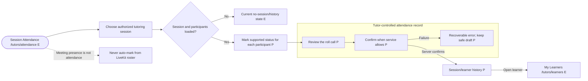

### Session Notes: `/tutors/session-notes` (P)

**Sections:** learner/group and session filters, tutor-only observations, and a separate learner-visible feedback draft/publish area.

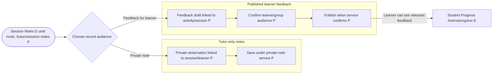

**Boundary:** Private notes never flow into learner profiles, group discussions, notifications, or progress exports. Publishing feedback is explicit and creates a distinct learner-visible record.

### Meeting Room: `/tutors/classrooms/meeting-room` (E)

**Sections:** invite/code lobby, connected LiveKit stage, participant panel, opt-in media controls, transient in-call chat/hand raise, and leave/host-end actions.

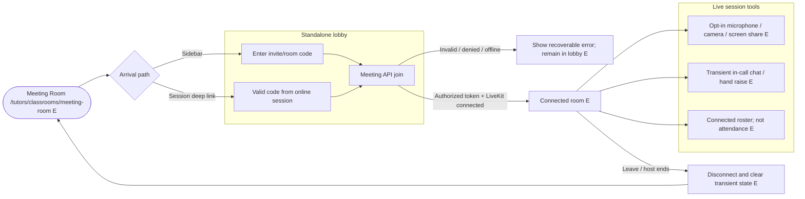

**Boundary:** Create/end permission comes from the server-issued host capability. In-call messages and room presence are neither saved Discussions nor official attendance. Don't imply every in-person/hybrid session has a room.

### Discussions: `/tutors/communication` (E scaffold)

**Sections:** learner/group/session context chooser, authorized thread list, author/audience/timestamp, thread detail, and reply composer when a communication service exists.

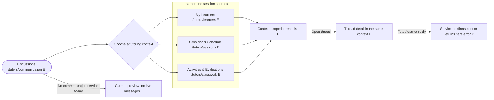

**Boundary:** Do not turn a session chat packet into a saved discussion. Direct private inbox messaging remains future.

### Announcements: `/tutors/announcements` (P)

**Sections:** authorized learner/group audience, compose/preview, published notices, and delivery state only if the service reports it.

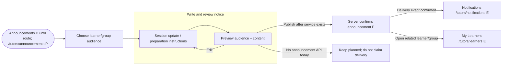

### Notifications: `/tutors/notifications` (E scaffold)

**Sections:** authorized event inbox, event/source labels, filters/read state only if supported, and a link back to the record that owns the event.

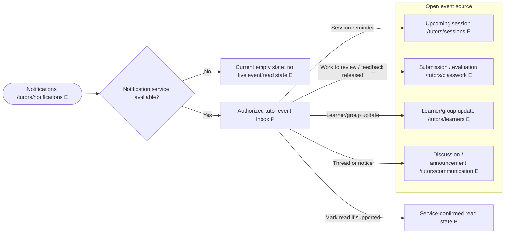

**Boundary:** Don't expose private session notes in inbox previews or claim a notice/reminder was delivered without service confirmation.

### Teaching Materials: `/tutors/materials` (E context chooser)

**Sections:** owner/context selector, learner/group/session/topic filters, resource results, supported detail/preview, and explicit share/attach action.

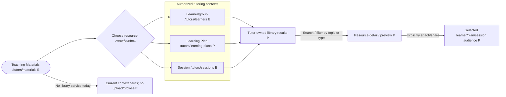

**Boundary:** A tutor-private resource does not become learner-visible until explicitly shared. File types, size, preview, storage, and external integrations require approved contracts.

### Student Progress: `/tutors/progress` (E scaffold)

**Sections:** individual/group selector, timeframe, completed sessions, attendance, activities/evaluations, learning-plan milestones, and learner-visible feedback with source labels.

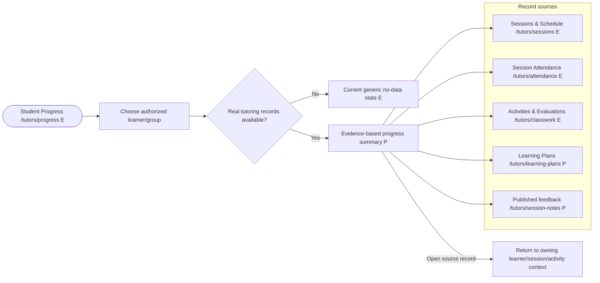

**Boundary:** Show tutor-defined criteria, date, and source; do not infer school grades, automated mastery, or group-wide access to individual notes.

### AI Tutor Assistant: `/tutors/ai-assistant` (E scaffold)

**Sections:** tutor-selected learner/group and goal context, prompt/task type, editable draft, review controls, and handoff to a learning plan/activity/session.

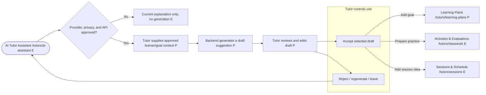

**Boundary:** This is a tutor-facing copilot, not an autonomous learner-facing AI tutor. It does not contact learners, assign work, make final evaluations, set mastery, or mutate attendance/progress records.

### Profile & Settings: `/tutors/settings` (P)

**Sections:** authenticated tutor profile, supported preferences, notification settings when available, and account actions. Sign-out remains in the shared header.

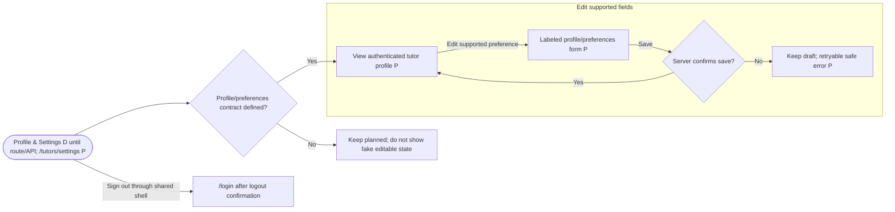

### Cross-page navigation and record-state rules

- Learner, group, plan, activity, session, attendance, private-note, feedback, and material routes retain their owner and audience context.
- Tabs, filters, dialogs, and list/board toggles stay on their current URL unless a flowchart names a destination. Proposed routes are not implicitly registered.
- Every create, submit, evaluate, publish, attendance, notification, and settings action has pending, confirmed success, and recoverable failure states. Do not claim success until a service confirms it.
- Loading, empty, filtered-empty, unavailable, error, and permission-denied states are distinct. Sample and in-memory tutoring records stay labeled as demo.
- Keep private Session Notes out of learner-facing views, group discussions, notifications, and progress summaries. Meeting presence/chat remain transient and never become attendance or saved messages.

## Delivery roadmap

### Stage 0 - Product/data contracts and access model

- Confirm tutor account/profile representation, ownership of learners/groups, invitations/membership, and backend authorization boundaries.
- Define learner versus group relationship, tutoring context, individual/group session participation, and what in-person/online/hybrid session modes are supported.
- Define Learning Plan and activity/submission data, evaluation/feedback visibility, private Session Note access/retention, attendance values/corrections, and progress evidence.
- Define timezone, recurrence, cancellation, reminders, material types/sharing, discussion audiences, announcement delivery, notification/read state, AI provider/privacy, and profile preferences before implementation.
- Defer direct messages, payments/subscriptions, tutoring-business invoicing, and advanced scheduling until separately approved.

### Stage 1 - Tutor workspace and learner relationships

- Finalize the tutor-specific grouped sidebar, navigation hrefs, page title, active-item logic, workspace search, and mobile/collapsed behavior.
- Keep every new/refactored tutor route folder to a thin `index.tsx` adapter; move screen content, forms, state, and domain logic to the mapped `tutor-workspace` feature components.
- Replace fake/stat placeholder content with real service data or clear no-data/loading/error/permission states.
- Establish tutor-owned learner/group records and My Learners views with backend isolation before exposing private learner data.
- Keep current classroom list/create/join behavior verified against the API, and separate connected classroom metadata from demo classroom prototype state.

### Stage 2 — Learning Plans, sessions, and schedule

- Add learner/group Learning Plans and connect plan goals to specific sessions and activities.
- Connect Sessions & Schedule to real session records with online/in-person/hybrid mode only as supported.
- Link Meeting Room only to a valid online session; avoid treating all tutoring appointments as video meetings.
- Resolve timezone/recurrence/cancellation behavior before calendar creation or reminders.

### Stage 3 — Activities, evaluations, attendance, and notes

- Implement tutor-authored practice/assignments, learner response/submission, evaluation, and feedback with a confirmed lifecycle.
- Add session attendance separate from LiveKit connectivity, including individual attendance within a group session.
- Implement tutor-only Session Notes separately from explicit learner-facing feedback; verify access and retention policies.

### Stage 4 — Materials, communication, and progress

- Connect the Teaching Materials library with explicit owner/audience and learner sharing.
- Add contextual Discussions, Announcements, and Notifications only with confirmed save/delivery/read contracts; direct Messages remain future.
- Build Student Progress from actual sessions, attendance, activities, evaluations, and published feedback, with learner/group privacy controls.

### Stage 5 — Tutor AI and account/settings

- Add tutor-facing AI drafts after provider/privacy/backend approvals; require human review and prohibit automatic learner contact or record changes.
- Add Profile & Settings using authenticated profile/preferences services.
- Revisit payments or tutoring-business scheduling only as a separately scoped future phase.

## Acceptance criteria for this plan and later implementation

- A tutor can follow a clear workflow from learner/group relationship through Learning Plan, sessions, material/activity, teaching, attendance, notes/feedback, and evidence-based progress.
- One-to-one and group tutoring are supported where the service contract allows them; the UX does not force school classes, terms, or school grading.
- Online, in-person, and hybrid sessions are represented only according to supported session modes; a Meeting Room is linked only when a valid online room exists.
- Attendance is an educator-controlled session record, not derived from meeting participants, connection time, or in-call messages.
- Tutor-only Session Notes cannot leak into learner feedback, discussions, notifications, or progress; published feedback has an explicit audience and publication action.
- Learner/group, activity, material, attendance, and progress records are scoped to the authorized tutor and context on the backend.
- Direct Messages remain future; contextual Discussions, Announcements, and Notifications are not described as functional until services confirm persistence/delivery/read state.
- Materials has a single clear owner/context; insights live with Student Progress and derive only from real authorized records.
- AI Tutor Assistant is clearly tutor-facing, outputs editable drafts, and cannot autonomously assign work, evaluate a learner, message a learner, or mutate official records.
- Sample and in-memory classroom/tutor data are never reported as live or server-saved; each page has appropriate loading, empty, error, unavailable, and permission-denied states.
- Tutor navigation changes stay under `/tutors`, keep page title/search/active state in sync, and do not alter student, educator, or ESL navigation unless separately approved.
- Every sidebar page in this blueprint has a route status, component/file ownership map, checked-in UI-wrapper recommendations, and a branching Mermaid click-flow diagram.
- New/refactored tutor route directories contain only `index.tsx`; feature views, sections, forms, schemas, and data orchestration live in `src/components/features/`.
- Each clickable sidebar item resolves to a registered tutor-prefixed route. Unimplemented destinations are disabled Planned items and excluded from header page search until added to `src/main.tsx`.
- No new dependencies, API routes, permissions, grade scales, file rules, or integrations are assumed without explicit approval.

## Likely application files if implementation is separately approved

- Tutor sidebar/navigation and layout mapping: `src/components/common/dashboard-navigation.ts`, `src/components/common/app-sidebar.tsx`, `src/pages/dashboard/layout.tsx`.
- Tutor routes/adapters: `src/main.tsx`; existing `src/pages/dashboard/tutors/{index,learners,sessions,classwork,attendance}/index.tsx`; proposed `learners/detail/index.tsx`, `learning-plans/index.tsx`, `session-notes/index.tsx`, `announcements/index.tsx`, and `settings/index.tsx`.
- Tutor feature views: `src/components/features/tutor-workspace/{overview,learners,learning-plans,activities,sessions,attendance,notes,materials,progress,communication,notifications,ai,settings}/`.
- Shared route adapters: `src/pages/dashboard/classroom/`, `schedule/`, `materials/`, `communication/`, `notifications/`, `progress/`, and `ai-assistant/`; keep shared classroom/meeting code role-aware and avoid a duplicate tutor-specific Meeting Room.
- Existing classroom integration/prototype: `src/services/api/classroom.service.ts`, `src/components/features/classrooms/classroom-prototype-context.ts`, `classroom-prototype-provider.tsx`, `classroom-mock-data.ts`, and shared classroom views. Keep mock state clearly separated while replacing flows with approved APIs.
- Meeting integration: `src/pages/dashboard/classroom/meeting-room.tsx` and `src/services/api/meeting.service.ts`; retain transient room chat/hand boundaries and do not add persistence without an approved contract.
- No application source, route, dependency, configuration, or backend changes are included in this planning document.
